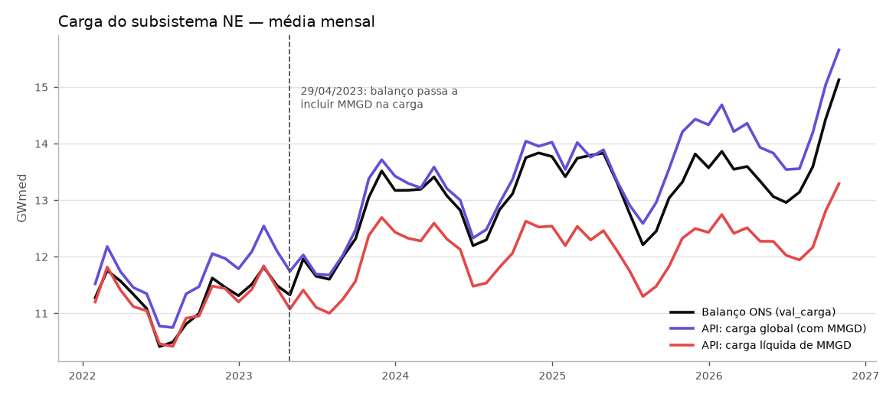
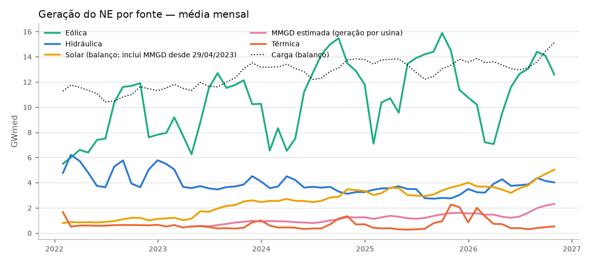
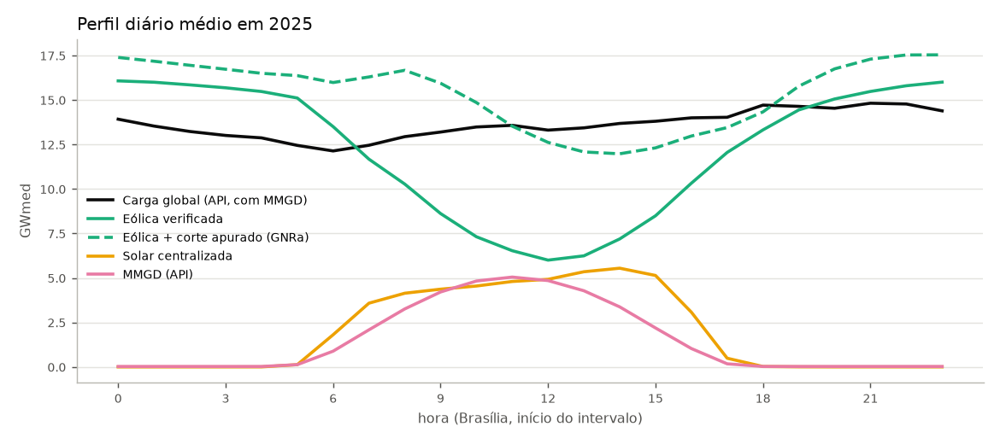
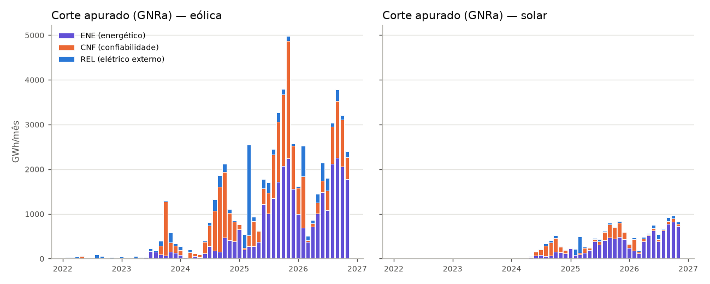
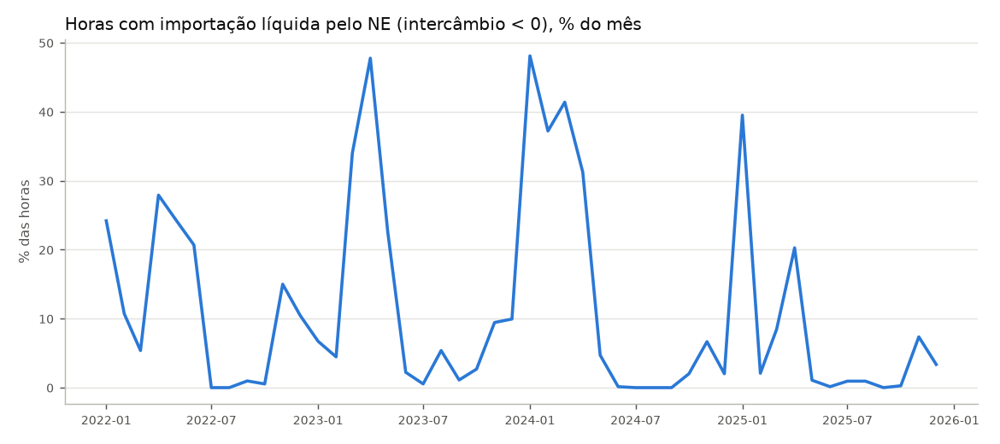
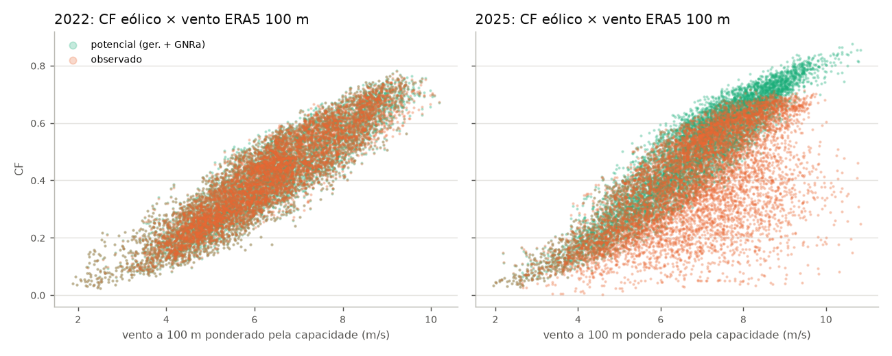

# Relatório de qualidade dos dados — Dia 1

Gerado por `python -m src.audit.run_audit` em 2026-11-11 22:16 UTC.
Recorte: subsistema Nordeste (ONS) — UFs AL, BA, CE, PB, PE, PI, RN, SE (o MA pertence ao subsistema Norte).
Convenção temporal da base integrada: `t` = início da hora, horário de Brasília (UTC−3, sem horário de verão no período).

## 1. Inventário de dados brutos

| fonte | conjunto | arquivos | MB |
|---|---|---|---|
| aneel | mmgd | 2 | 108.2 |
| aneel | siga | 2 | 8.1 |
| epe | pde2035 | 25 | 48.9 |
| ibge | (arquivos na raiz da fonte) | 1 | 0 |
| ons | balanco | 7 | 11 |
| ons | capacidade | 3 | 0.5 |
| ons | carga_verificada | 59 | 3 |
| ons | coff_eolica | 61 | 193.3 |
| ons | coff_solar | 34 | 35.8 |
| ons | curva_carga | 7 | 2.5 |
| ons | fator_capacidade | 61 | 183.1 |
| ons | geracao_usina | 61 | 259.2 |
| ons | intercambio | 7 | 4 |
| openmeteo | (arquivos na raiz da fonte) | 34 | 9.1 |

Detalhe por arquivo: `reports/tables/inventario_raw.csv`; origem, URL, SHA-256 e data de coleta: `docs/manifest/manifest.csv`.

## 2. Cobertura horária na base integrada (`data/interim/ne_hourly.parquet`)

| bloco | coluna | inicio | fim | horas_esperadas | horas_presentes | lacunas_internas |
|---|---|---|---|---|---|---|
| balanço ONS | bal_carga | 2022-01-01 00:00:00 | 2026-11-09 23:00:00 | 42576 | 42576 | 0 |
| carga verificada API | api_cargaglobal | 2022-01-01 00:00:00 | 2026-11-11 23:00:00 | 42624 | 42624 | 0 |
| geração por usina | gu_eol_desp | 2022-01-01 00:00:00 | 2026-11-10 23:00:00 | 42600 | 42600 | 0 |
| MMGD em geração por usina | gu_sol_mmgd | 2023-04-29 00:00:00 | 2026-11-10 23:00:00 | 31008 | 31008 | 0 |
| FC eólico ONS | fc_eol_cap | 2022-01-01 00:00:00 | 2026-11-09 23:00:00 | 42576 | 42576 | 0 |
| FC solar ONS | fc_sol_cap | 2022-01-01 00:00:00 | 2026-11-09 23:00:00 | 42576 | 42576 | 0 |
| constrained-off eólico | coff_eol_geracao | 2022-01-01 00:00:00 | 2026-11-10 23:00:00 | 42600 | 42600 | 0 |
| constrained-off solar | coff_sol_geracao | 2024-04-01 00:00:00 | 2026-11-10 23:00:00 | 22896 | 22896 | 0 |
| clima ERA5 (ponderado) | w_temperature_2m_pop | 2022-01-01 00:00:00 | 2026-11-03 19:00:00 | 42428 | 42428 | 0 |

## 3. Checagens nas bases brutas

| checagem | resultado |
|---|---|
| balanco_duplicatas_(subsistema,t) | 0 |
| balanco_negativos_exceto_intercambio | 1 |
| balanco_valores_nao_numericos | 0 |
| carga_api_duplicatas_t | 0 |
| carga_api_consistencia_nao_nula_(30min) | 2,629 |
| coff_eol_usina_h_duplicatas_(usina,t) | 0 |
| coff_eol_usina_h_horas_incompletas_(n_sub!=2) | 0 |
| coff_eol_usina_h_ref<ger_(% horas-usina) | 45.4 |
| coff_sol_usina_h_duplicatas_(usina,t) | 0 |
| coff_sol_usina_h_horas_incompletas_(n_sub!=2) | 0 |
| coff_sol_usina_h_ref<ger_(% horas-usina) | 21 |
| fc_duplicatas_(usina,t) | 0 |
| fc_cf_fora_[0,1] | 4,411 |
| fc_cf_>1.05_recalculado | 1,796 |
| fc_capacidade_zero_ou_nula | 3,888 |

## 4. Reconciliação (médias trimestrais, MWmed)

- `res_balanco_G-L-I`: geração (hid+ter+eol+sol) − carga − intercâmbio no balanço ONS (intercâmbio > 0 = exportação).
- `carga_bal_liq_menos_api_liq`: carga do balanço menos MMGD de "geração por usina" versus carga líquida de MMGD da API.
- `mmgd_api_menos_mmgd_usina`: diferença entre as duas estimativas de MMGD publicadas pelo ONS.
- `eol_fc_sobre_bal_%`: geração eólica do conjunto FC (usinas despachadas) sobre a eólica do balanço.

| t | res_balanco_G-L-I | carga_bal_liq_menos_api_liq | mmgd_api_menos_mmgd_usina | eol_bal_menos_soma_usinas | eol_fc_sobre_bal_% |
|---|---|---|---|---|---|
| 2022-03-31 00:00:00 | 0 | 61.6 |  | 0 | 93.6 |
| 2022-06-30 00:00:00 | 0 | 68.1 |  | 0 | 95.6 |
| 2022-09-30 00:00:00 | 0 | 5.2 |  | 0 | 95.7 |
| 2022-12-31 00:00:00 | -0 | 91.8 |  | -0 | 93.7 |
| 2023-03-31 00:00:00 | 0 | 41.2 |  | 0 | 94.7 |
| 2023-06-30 00:00:00 | -0 | 69.5 | 56.1 | 0 | 96.2 |
| 2023-09-30 00:00:00 | 0 | -27.2 | 59.4 | 0 | 95.7 |
| 2023-12-31 00:00:00 | 0 | -175 | 85.7 | -0 | 94.2 |
| 2024-03-31 00:00:00 | 0 | -75.2 | 33.6 | -0 | 93 |
| 2024-06-30 00:00:00 | -0 | -100.8 | 46.8 | -0 | 96.2 |
| 2024-09-30 00:00:00 | -0 | -44.6 | 141.1 | 0 | 95.9 |
| 2024-12-31 00:00:00 | 0 | -28.4 | 193.5 | 0 | 94.5 |
| 2025-03-31 00:00:00 | -0 | 65.8 | 183.7 | 0.6 | 94.8 |
| 2025-06-30 00:00:00 | -0 | 1.3 | 77.2 | -59.3 | 96.8 |
| 2025-09-30 00:00:00 | -0 | -313.2 | 153.4 | -137.6 | 96.3 |
| 2025-12-31 00:00:00 | -0 | -430.9 | 325.2 | -110.2 | 94.7 |
| 2026-03-31 00:00:00 | -359.1 | -381.5 | 372.5 | -359.9 | 195.3 |
| 2026-06-30 00:00:00 | -165.6 | -340.9 | 308.8 | -108.2 | 155.2 |
| 2026-09-30 00:00:00 | 0 | -503.4 | 38.2 | -181.2 | 95.5 |
| 2026-12-31 00:00:00 | 0 | -440.6 | 51.7 | -90.3 | 94.4 |

Horas em que o balanço não fecha (|G−L−I| > 50 MW), por mês:

| t | horas |
|---|---|
| 2026-01 | 255 |
| 2026-02 | 170 |
| 2026-03 | 203 |
| 2026-04 | 151 |
| 2026-05 | 99 |

## 5. Constrained-off apurado (GNRa) por ano

| ano | fonte | geracao_TWh | GNRa_TWh | ENE_TWh | CNF_TWh | REL_TWh | PAR_TWh | horas_cobertas | corte_%_do_potencial |
|---|---|---|---|---|---|---|---|---|---|
| 2022 | eólica | 69.651 | 0.407 | 0.034 | 0.135 | 0.241 | 0 | 8760 | 0.581 |
| 2023 | eólica | 83.882 | 3.428 | 0.9 | 1.884 | 0.674 | 0 | 8760 | 3.926 |
| 2024 | eólica | 94.71 | 9.536 | 2.758 | 5.944 | 0.961 | 0 | 8784 | 9.147 |
| 2025 | eólica | 102.69 | 25.985 | 13.27 | 10.002 | 3.545 | 0 | 8760 | 20.194 |
| 2026 | eólica | 83.159 | 21.829 | 14.067 | 5.851 | 2.403 | 0 | 7536 | 20.792 |
| 2024 | solar | 11.806 | 2.367 | 0.92 | 1.277 | 0.206 | 0 | 6600 | 16.699 |
| 2025 | solar | 16.827 | 5.793 | 3.667 | 1.599 | 0.719 | 0 | 8760 | 25.61 |
| 2026 | solar | 17.478 | 6.431 | 5.406 | 0.63 | 0.548 | 0 | 7536 | 26.898 |

## 6. Checagem física das variáveis meteorológicas (correlações horárias)

| ano | corr(vento3_100m, CF_eol_observado) | corr(vento3_100m, CF_eol_potencial) | corr(GHI, CF_solar_observado) | corr(T2m_pop, carga_liquida_api) |
|---|---|---|---|---|
| 2,022 | 0.872 | 0.872 | 0.954 | 0.095 |
| 2,023 | 0.77 | 0.851 | 0.923 | -0.139 |
| 2,024 | 0.764 | 0.884 | 0.898 | -0.296 |
| 2,025 | 0.578 | 0.882 | 0.854 | -0.428 |
| 2,026 | 0.604 | 0.887 | 0.864 | -0.519 |

## 7. Figuras

