# Relatório técnico — Data centers e expansão eólica no balanço horário do Nordeste (2030)

Documento de apresentação do projeto, passo a passo. Gerado por `python -m src.report.tecnico` em
2026-11-17 03:28 UTC, a partir das tabelas produzidas pelo pipeline.
Os números citados vêm de arquivos em `reports/` e `config/`; os poucos valores de análises exploratórias
trazem a decisão de `docs/decisoes.md` em que estão registrados.

## Sumário executivo

**Pergunta.** Se data centers entrarem no subsistema Nordeste até 2030, quanto aumenta a energia que a
região precisa importar do resto do país, em que horas isso acontece, e quanta capacidade eólica nova
compensaria esse consumo?

**Como respondemos.** Em quatro etapas, cada uma alimentando a seguinte:
1. **Dados.** Coletamos e auditamos dados horários de operação do ONS (2022–2025), cadastros da ANEEL,
   planos oficiais (PDE 2035 e PLAN 2026–2030) e 31 anos de reanálise climática ERA5.
2. **Modelos.** Treinamos modelos de *machine learning* (gradient boosting) que transformam clima e
   calendário em perfis horários de carga, geração eólica, geração solar e MMGD.
3. **Simulador.** Um simulador monta, hora a hora, o balanço de 2030 sob cenários de data centers e de
   expansão eólica.
4. **Monte Carlo.** Uma simulação Monte Carlo repete esse balanço 2.000 vezes com climas e hidrologias
   diferentes, para medir a incerteza.

**Principais resultados (2030, eólica base).**
- **Importação.** A importação média vai de **2,9 TWh/ano** sem
  novos data centers para **5,2 TWh/ano** com a carga de data
  centers projetada oficialmente (2.098 MWmed).
  - No mesmo clima, o acréscimo é de +2,3 TWh e
    +449 horas com importação por ano.
  - O acréscimo aparece em 100% dos cenários climáticos simulados.
- **Quando a importação acontece.** No fim da tarde (pico às 18h, quando a solar cai) e de madrugada.
  Ao meio-dia ela é praticamente nula.
- **Compensação eólica.** Compensar em **energia anual** exigiria
  4,6 GW eólicos a mais. Compensar a **importação
  anual** exigiria 10,4 GW,
  2,3
  vezes mais.
- **Excedente.** O NE continua fortemente exportador (excedente de
  ~76 TWh/ano). 88%
  da energia dos data centers cairia em horas de excedente regional.
- **Clima e hipóteses.** O clima do ano pesa tanto quanto a escolha de cenário. Os resultados também são
  sensíveis à carga de data centers, que a projeção oficial revisou de 716
  para 2.098 MWmed em oito meses, e à operação hidráulica.
- **Quanto confiar.** Rodado com os níveis observados de 2022–2025, o simulador erra a importação anual
  entre -20% e +8% (seção 7.4). O nível absoluto
  de 2030 carrega um erro dessa ordem; o efeito dos data centers, medido por diferença pareada, varia
  menos.
- **Backtest de 2026 (seção 7.5).** A importação observada de jan–out (1,68 TWh) cai dentro da
  faixa ex-ante do cenário de 2026 (percentil 74). Com o clima e a hidrologia reais, porém, o
  simulador a subestima. Há duas causas.
  - Um erro de método, já corrigido: o coeficiente da regra hidráulica era estimado sobre a carga líquida
    já cortada. Com a correção, a importação de 2030 (DC central, eólica base) passou de
    5,04 para 5,18 TWh.
  - Uma limitação sistemática, não corrigida: a eólica simulada tem poucas horas de pouco vento na frota
    recente. Por isso, a importação de 2030 tende a estar subestimada.

## 1. Contexto, pergunta e escopo

**Contexto.**
- O Nordeste concentra a maior parte da geração eólica do Brasil e hoje exporta energia para o resto do
  SIN na grande maioria das horas (86–93% das horas em 2022–2025).
- Ao mesmo tempo, há um volume crescente de pedidos de conexão de grandes cargas, sobretudo data centers
  e hidrogênio, na região (Pecém/CE, Bahia, Piauí).
- Uma carga de data center é praticamente constante nas 24 horas, enquanto a eólica e a solar variam ao
  longo do dia e do ano. A pergunta não é só "há energia suficiente no ano?", mas "em quais horas falta?".

**Pergunta de pesquisa.** Sob diferentes cenários de entrada de data centers e de expansão eólica, como
mudam a necessidade de importação e os excedentes horários do subsistema Nordeste em 2030, e quanto de
expansão eólica compensaria o consumo adicional?

**Variável central.** A margem horária do NE:

> M(t) = G_NE(t) − [L_base(t) + L_DC(t)] · importação = max(0, −M) · excedente = max(0, M)

G_NE é a geração do subsistema, L_base a carga sem novos data centers e L_DC a carga incremental de data
centers.
- M negativa significa que o NE precisa **importar** do restante do SIN naquela hora. **Não** significa
  déficit de suprimento ou blackout.
- M positiva é **excedente** regional, que pode ser exportado ou cortado.

**Recorte e escopo.**
- **Região.** Subsistema Nordeste do ONS, formado por AL, BA, CE, PB, PE, PI, RN e SE. O Maranhão
  pertence ao subsistema Norte.
- **Período.** Histórico de calibração 2022–2025; ano-alvo 2030.
- **Fora do escopo.** Fluxo de potência e rede elétrica interna, adequação de suprimento do SIN e
  viabilidade econômica.
- **Natureza dos resultados.** São **condicionais a cenários** declarados, não previsões.

**Glossário mínimo.**
- **MWmed:** potência média num intervalo. 1 MWmed durante 1 hora = 1 MWh; a média anual em MWmed × 8.760
  h = energia anual em MWh.
- **CF (fator de capacidade):** geração ÷ capacidade instalada, entre 0 e 1.
- **Constrained-off / GNRa:** redução da geração eólica ou solar por ordem do ONS. A GNRa (geração não
  realizada apurada) é a estimativa oficial da energia cortada.
- **CF potencial:** (geração + GNRa) ÷ capacidade, isto é, o que o vento permitiria gerar sem corte.
- **MMGD:** micro e minigeração distribuída, a solar nos telhados. Reduz a carga vista pela rede durante o dia.
- **Rede Básica:** rede de transmissão de alta tensão. Os grandes data centers se conectam a ela.
- **PLAN / RQ:** Planejamento Anual da Operação Energética do ONS/EPE/CCEE e suas Revisões Quadrimestrais
  da previsão de carga.
- **PDE:** Plano Decenal de Expansão de Energia (EPE).
- **ERA5:** reanálise climática global do ECMWF, uma "reconstrução" horária do clima desde 1940.
- **HGB:** HistGradientBoosting, o algoritmo de *machine learning* usado (seção 5.1).

## 2. Visão geral do pipeline

O projeto é um pipeline reprodutível em Python: cada etapa é um módulo que lê arquivos da etapa anterior
e grava os seus. O comando `python -m src.pipeline` refaz tudo a partir dos dados brutos, e foi conferido
que a reexecução reproduz exatamente os mesmos números.

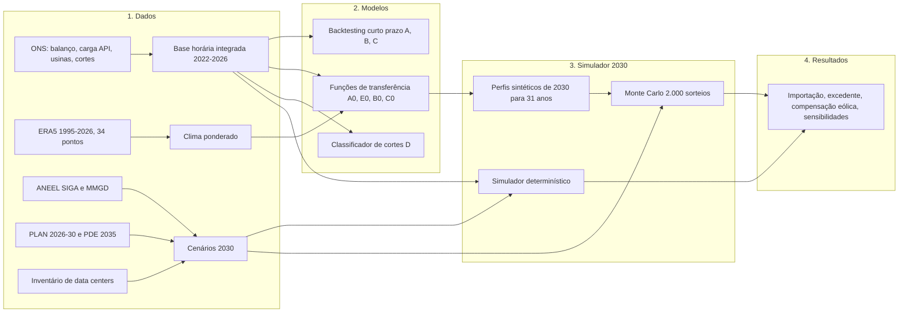

| Etapa | Módulo | Entrada | Saída |
|---|---|---|---|
| Coleta | `src/collect/*` | APIs e portais oficiais | `data/raw/` e manifesto com SHA-256 |
| Integração | `src/build/ne_hourly.py` | brutos ONS e ERA5 | base horária do NE (`data/interim/`) |
| Auditoria | `src/audit/run_audit.py` | base integrada | relatório de qualidade, tabelas, figuras |
| Features | `src/features/build.py`, `clima_historico.py` | base integrada, ERA5 | base analítica; clima 1995–2026 |
| Modelos | `src/models/backtest.py`, `cortes.py` | base analítica | métricas de validação |
| Perfis sintéticos | `src/sim/sinteticos.py` | modelos A0/E0/B0/C0, clima | perfis de 2030 para 31 anos e resíduos |
| Simulador | `src/sim/deterministico.py`, `montecarlo.py` | perfis, cenários | distribuições de importação etc. |
| Relatórios | `src/report/*` | tabelas | este documento |

## 3. Dados coletados e onde cada um entra

A coleta foi feita por scripts. Cada arquivo foi registrado num manifesto (`docs/manifest/manifest.csv`,
451 registros) com URL de origem, data de coleta, tamanho e hash SHA-256. No total são
469 arquivos brutos e 0,93 GB.

| Fonte / conjunto | Resolução e período | Variáveis principais | Como é usado no estudo |
|---|---|---|---|
| ONS — balanço de energia por subsistema | horária, 2022-01 → 2026-11 | carga, geração hidráulica, térmica, eólica, solar, intercâmbio | fechamento do balanço; hidráulica e térmica do simulador; intercâmbio observado |
| ONS — carga verificada (API) | 30 min → horária, 2022-01 → 2026-11 | carga global, carga líquida de MMGD, MMGD | alvo dos modelos A e A0; MMGD (E0); nível e forma da carga |
| ONS — geração por usina | horária, 2022-01 → 2026-11 | geração de cada usina, inclusive grupos MMGD | separar MMGD da solar do balanço; conferências |
| ONS — fator de capacidade por usina | horária, 2022-01 → 2026-11 | geração e capacidade de cada usina eólica/solar, coordenadas | denominador do CF; alvo dos modelos B, B0, C, C0; pesos espaciais do clima |
| ONS — constrained-off eólico e solar | 30 min → horária; eólica 2022-01+, solar 2024-04+ | geração, referência, corte apurado (GNRa) por motivo | CF potencial = (geração + GNRa)/capacidade; rótulos do classificador D |
| ONS — capacidade instalada | fotografia | unidades geradoras, datas de operação | conferência das capacidades |
| ANEEL — SIGA | fotografia 2026-11-01 | empreendimentos por fase, potência, coordenadas | pontos ERA5 (clusters); cenários eólicos de 2030 |
| ANEEL — MMGD | fotografia 2026-11-10 | potência de micro e minigeração por UF | caracterização; contém dados pessoais tarjados (só agregados) |
| Open-Meteo (ERA5) | horária, 1995-01 → 2026-11, 34 pontos | temperatura, umidade, temperatura aparente, vento a 100 m, irradiância | features de todos os modelos de carga, eólica e solar |
| IBGE — Censo 2022 | por UF | população | pesos da temperatura das capitais |
| Calendário (biblioteca holidays) | diária, 2015–2030 | feriados nacionais e estaduais, Carnaval, São João, pontes | features de calendário dos modelos de carga |
| EPE — PDE 2035 | anual | carga por subsistema, MMGD, expansão indicativa, limite de exportação | sensibilidade de carga; cenário eólico alto; limite de 21 GW |
| ONS/EPE/CCEE — PLAN 2026–2030 (PLAN, 1ª e 2ª RQ) | anual, 2026–2030 | carga do NE, MMGD, carga de data centers de Rede Básica | nível de carga e MMGD de 2030; cenários de data centers |
| Inventário documental de data centers | 17 itens | potência, definição, maturidade, fonte | componente do cenário alto; conferência das projeções |

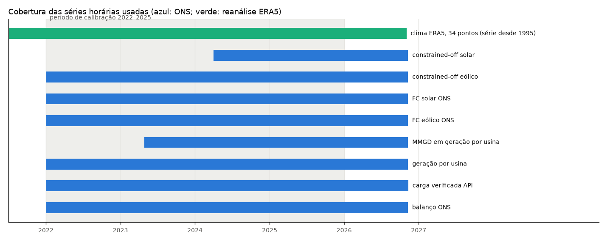

As séries do ONS cobrem de 2022 a 2026 sem lacunas internas (Figura 1). Duas exceções: o
constrained-off solar só existe desde 2024-04, e a MMGD aparece na geração por usina só desde 2023-04-29.

O clima é amostrado em 34 pontos (Figura 2):
- **8 capitais:** temperatura, umidade e irradiância, ponderadas pela população de cada UF. Representam a
  demanda.
- **16 pontos eólicos e 10 solares:** escolhidos por *k-means* sobre as coordenadas das usinas do SIGA,
  ponderado pela potência. Cada usina é associada ao ponto mais próximo, e o vento de cada ponto é
  ponderado pela capacidade das usinas que ele representa.

A rede de usinas despachadas pelo ONS no NE soma 139 usinas ou conjuntos eólicos
(32,2 GW) e 56 solares (11,4 GW).

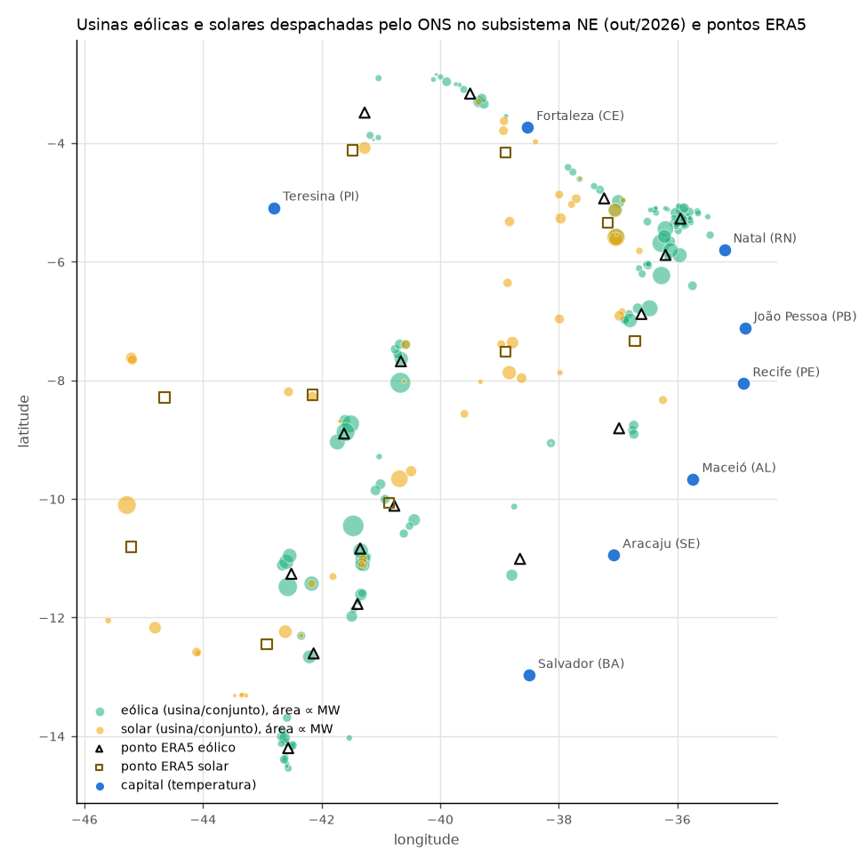

## 4. Tratamento e caracterização dos dados

### 4.1 Harmonização temporal e de unidades

Todas as séries foram levadas a uma mesma convenção: `t` = início da hora, no horário de Brasília (UTC−3;
não há horário de verão desde 2019).
- **API de carga.** Informa o *fim* do intervalo de 30 minutos em UTC. Foi convertida para o início do
  intervalo em Brasília.
- **Agregação para hora.** Os pares de 30 minutos foram agregados pela média dos MWmed, que equivale à
  energia da hora em MWh.
- **ERA5.** As variáveis instantâneas (vento, temperatura) foram alinhadas à hora do ONS pela média dos
  instantes t e t+1h. A irradiância, que é média da hora anterior, foi alinhada pelo valor rotulado t+1h.
- **Sem imputação.** Nenhuma lacuna foi preenchida, e anomalias foram marcadas, não recortadas.
- **Testes automatizados.** Verificam a conversão de fuso, a agregação, MW × h = MWh, a ausência de
  duplicatas e a cardinalidade das junções.

### 4.2 Qualidade e reconciliação

- **Duplicatas e lacunas.** Nenhuma duplicata de chave e nenhuma lacuna interna nas bases centrais.
- **Fechamento do balanço.** O balanço do ONS fecha exatamente (geração − carga − intercâmbio = 0) em
  2022–2025. Em jan–mai/2026 há 878 horas que não fecham, porque os dados ainda estão em consistência.
- **Intercâmbio.** O intercâmbio entre subsistemas reconcilia com o do balanço quando somado com sinal.
- **Inconsistências.** A tabela abaixo consolida as inconsistências encontradas e o que foi decidido para
  seguir.

| Inconsistência ou achado | Problema | Decisão | Efeito nos modelos e resultados |
|---|---|---|---|
| Balanço do ONS passa a incluir a MMGD em 29/04/2023 (degrau de ~0,5 GW na carga) | carga e solar com definições diferentes antes e depois | usar a carga da API (definição homogênea) e tratar a MMGD como série própria | modelos de carga sem quebra artificial; MMGD projetada à parte |
| Duas estimativas de MMGD do ONS diferem em 30–370 MWmed por trimestre | incerteza na parcela distribuída | usar a estimativa da API, coerente com a carga usada | documentado; sensibilidade de MMGD |
| Geração de referência do constrained-off abaixo da geração em 45,4% das horas-usina | a referência não é o potencial físico | potencial = geração + GNRa apurada (só nas horas restritas) | alvo B/B0 sem contar corte em dobro |
| Corte eólico de 0,6% (2022) para 20,2% (2025) do potencial | CF observado deixa de refletir o vento | modelar o CF potencial; classificador só descritivo | perfis de 2030 representam o recurso, não o corte histórico |
| CF potencial salta de 0,42 (2024) para 0,48 (2025) | parte é clima, parte é frota nova | treinar B0/C0 na frota recente; fator de frota no determinístico | não subestimar a geração de 2030 |
| Balanço de jan–mai/2026: 878 horas não fecham | dados ainda em consistência | 2026 fica fora da calibração do balanço | nenhuma |
| FC por usina: 3.888 horas-usina com capacidade 0 e 1.796 com geração > 105% da capacidade | registro de capacidade defasado | excluir capacidade 0 do CF agregado; não recortar valores | impacto ≈ 0,3 TWh em ~450 TWh |
| SIGA sem datas previstas para projetos fora de operação | não dá para datar a expansão | cenários eólicos por fase (operação, construção) + expansão indicativa do PDE | eólica de 2030 é hipótese de cenário |
| PDE 2035 não separa data centers por subsistema | não dá para reproduzir a projeção de DC do PDE | usar a projeção do PLAN (ONS/EPE/CCEE), que separa | cenários de DC com fonte oficial e sem dupla contagem |
| Slides da 2ª RQ do PLAN só por download manual (HTTP 403) | rastreabilidade | download manual registrado no manifesto; valores lidos dos rótulos dos gráficos | documentado |
| Dados de ERA5 sem ciclo noturno do vento (jato noturno) | o vento explica menos o padrão diário | hora como feature; resíduos com ciclo diário preservado | perfil diário do CF reproduzido |
| Sem limite de importação documentado para o NE | não há como medir risco de suprimento | reportar só horas acima de 6/8/10 GW (sensibilidade) | nenhuma afirmação de risco de déficit |
| Carga global de 2025: 13.623 MWmed na API do ONS e 13.445 no PLAN; a carga líquida da API também supera a do balanço a partir de 2025-T3 | forma (API) e nível (PLAN) vêm de conceitos ligeiramente diferentes | manter o nível do PLAN; nível da API como sensibilidade | +0,31 TWh na importação média |
| CF solar potencial agregado acima de 0,85 em 228 horas (ago–out/2026) | poderia ser capacidade defasada | investigado: o potencial passa da capacidade em menos de 1% das horas-usina; mantido sem recorte | nenhum na importação (horas de excedente) |

### 4.3 Carga e MMGD

**Mudança de definição.** A análise exploratória da carga revelou um degrau de cerca de 0,5 GW em
29/04/2023 (Figura 3). Nessa data o balanço do ONS passou a somar a MMGD estimada tanto à carga quanto à
geração solar. O balanço continuou fechando, mas a série de carga mudou de definição. Se usada
diretamente, essa mudança seria interpretada pelos modelos como um salto real de consumo.
- **Decisão.** Usar a carga da API de carga verificada do ONS, que traz separadamente a carga global, a
  carga líquida de MMGD e a MMGD, com definição homogênea desde 2022.
- **Na modelagem**, a forma horária é modelada sobre a **carga bruta**. A carga líquida muda de forma ao
  longo dos anos porque a MMGD "cava" o meio-dia cada vez mais. A MMGD tem um modelo próprio (E0).

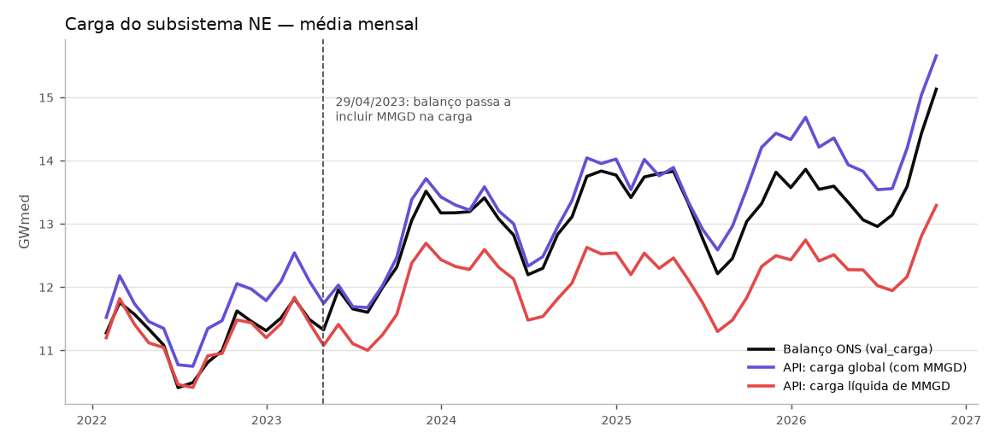

**Perfis horários.** Os mapas de calor hora × mês (Figura 4) e o perfil diário médio (Figura 5)
mostram a complementaridade das fontes:
- **Carga líquida:** mínima ao meio-dia, por causa da MMGD, e máxima entre 18h e 22h.
- **Eólica:** forte à noite e na madrugada, com safra entre julho e novembro.
- **Solar e MMGD:** só durante o dia.

A janela crítica é o início da noite: a solar já caiu e a eólica ainda não subiu totalmente. Esses
padrões justificam usar **hora e mês como features** em todos os modelos e reaparecem nos resultados de
2030.

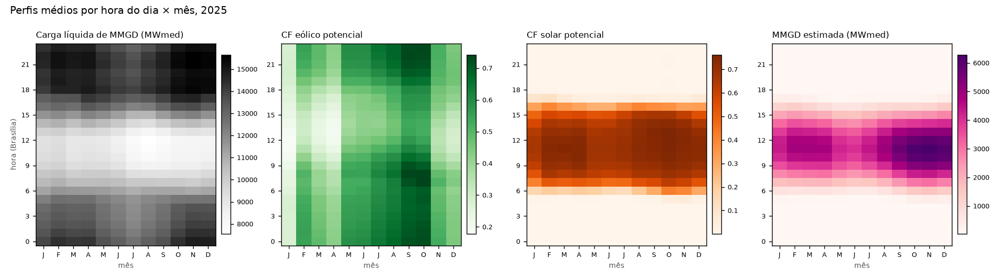

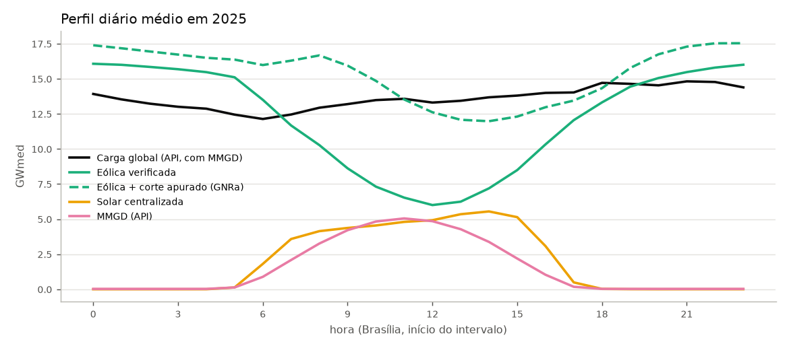

**Temperatura e calendário.** A carga diária cresce com a temperatura (Figura 6), com correlação de
0,64 nos dias úteis e ~3,5% de carga a mais por
°C. Fins de semana e feriados ficam ~7,6% abaixo. Daí as features de
temperatura (temperatura, temperatura aparente, graus-hora de resfriamento) e de calendário (dia da
semana, feriados nacionais e estaduais, Carnaval, São João, pontes) dos modelos de carga.

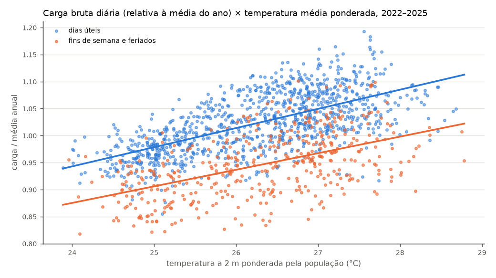

### 4.4 Geração eólica e cortes

**Capacidade.** A capacidade eólica do NE cresceu de ~20 GW para ~32 GW entre 2022 e 2026; a solar
centralizada, de ~3,5 para ~11,5 GW (Figura 7). A geração por fonte está na Figura 8.
- **Ponto de partida dos cenários.** A capacidade observada em 2026 é a base dos cenários de 2030.
- **Limite do SIGA.** O cadastro aberto do SIGA não traz datas previstas para projetos fora de operação,
  por isso os cenários eólicos são definidos por fase do empreendimento (seção 6).

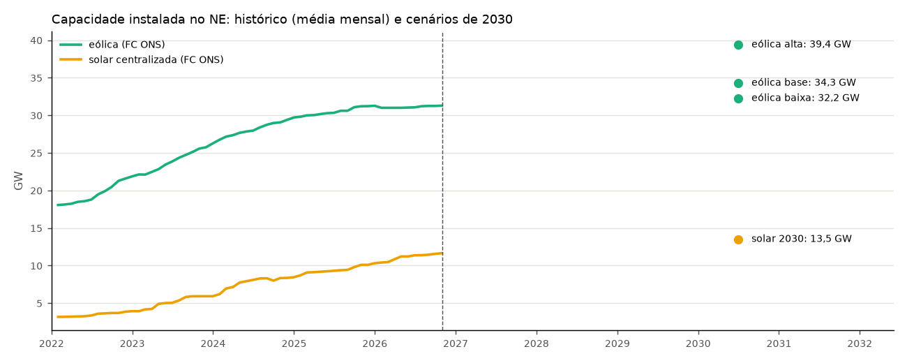

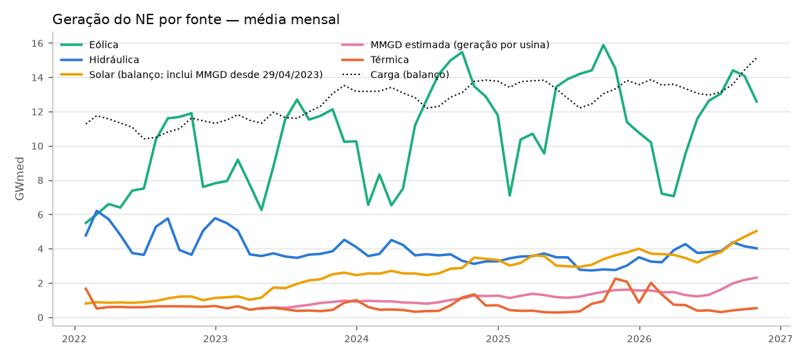

**Cortes (constrained-off).** O corte eólico apurado subiu de 0,6%
do potencial em 2022 para 3,9% (2023),
9,1% (2024) e 20,2% em 2025
(26,0 TWh). O corte solar foi de 25,6% em
2025 (Figura 9). Em 2025 o motivo energético (ENE, excesso de oferta no sistema) passou a dominar.

**Quando os cortes acontecem** (Figura 10).
- **Corte energético (ENE):** concentra-se **de dia**, entre ~9h e 15h, de maio a novembro. É quando a
  solar, a MMGD e uma eólica ainda forte se somam a uma carga líquida baixa.
- **Corte por confiabilidade (CNF):** concentra-se nas manhãs de julho a outubro.
- **Corte elétrico externo (REL):** em 2025, vem sobretudo de um evento em fevereiro.

Esse padrão indica que o excedente atual é, em grande parte, diurno, e é nessas horas que uma carga
constante de data centers absorveria energia.

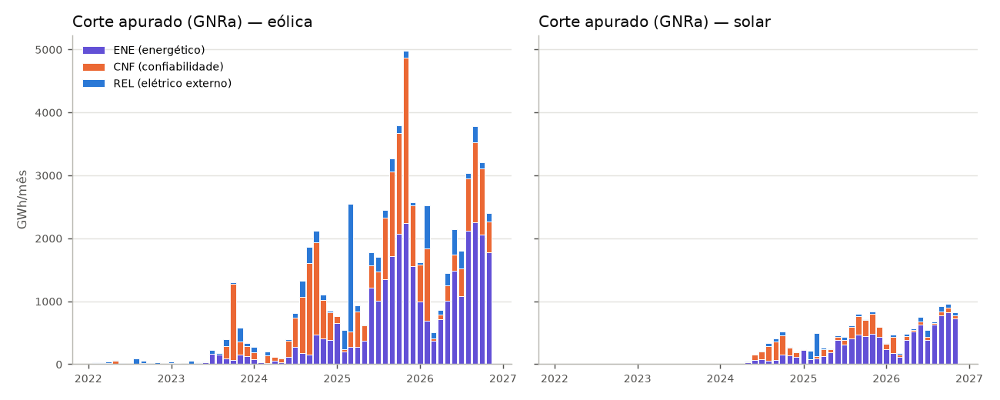

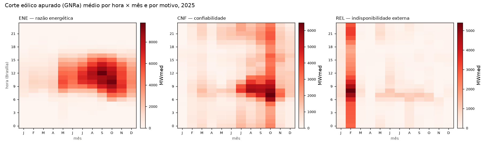

**Consequência para a modelagem.** O CF eólico *observado* deixou de refletir o vento (Figura 11).
- **Correlação.** A correlação entre vento³ e CF observado caiu de 0,87 (2022) para
  0,58 (2025), enquanto com o CF *potencial* (geração + corte apurado) ela fica em
  0,85–0,88.
- **Alvo.** Por isso o alvo dos modelos eólicos é o **CF potencial**: queremos o recurso físico, e o corte
  é justamente uma das saídas que o balanço deve revelar, não um dado de entrada.
- **Por que não a geração de referência.** O ONS publica uma "geração de referência", mas ela não serve
  como potencial: fica abaixo da geração verificada em 45,4%
  das horas-usina. Por isso o corte vem da GNRa, que o ONS apura apenas nas horas com restrição.

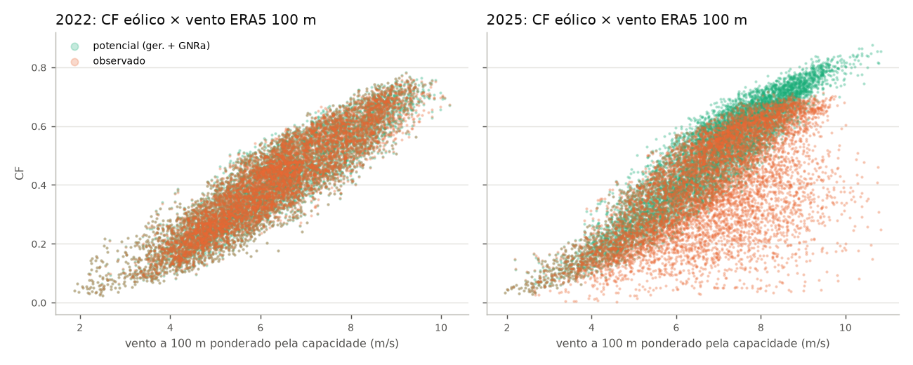

**Frota mais eficiente.** O CF potencial médio subiu de 0,42 (2024) para 0,48 (2025). A análise por faixa
de vento mostrou duas causas: 2025 foi mais ventoso, e a frota nova tem curva de potência 5–10% maior
(decisão 20).
Por isso os modelos que projetam 2030 são treinados só na frota recente (2024-07 em diante), e o simulador
determinístico aplica um **fator de frota** por ano (1,05–1,09 para 2022–2024; ~1,00 para 2025).

**Ciclo diurno e limitação do ERA5.** O CF potencial é ~13% maior à
noite e ~21% menor ao meio-dia em relação à média do dia. O vento³
do ERA5 varia menos: ~3% à noite (Figura 12). A reanálise, com
resolução de ~30 km, suaviza o reforço noturno do vento observado nos parques do NE. Por isso a **hora do dia** é
uma feature importante do modelo eólico (seção 5.4), e os resíduos reamostrados no Monte Carlo preservam
o ciclo diário.

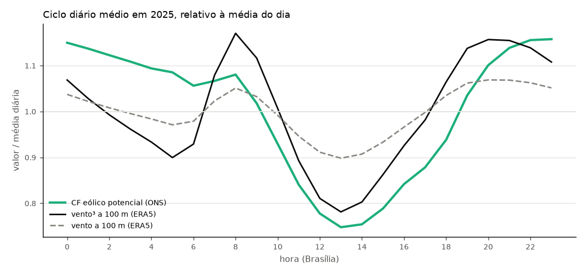

### 4.5 Balanço, intercâmbio e importação

O NE foi exportador líquido em todo o período, de 33 TWh em 2022 a
55 TWh em 2025. Ainda assim importou em
7–14% das horas (Figura 13).
- **Horários.** As importações históricas concentram-se de madrugada
  (~16% das horas entre 1h e 4h) e às 17h
  (~18%), e são raras ao meio-dia (~6%)
  (Figura 14).
- **Consequência.** Esse padrão antecipa o resultado principal: carga constante de data centers aumenta
  a importação justamente nas horas em que a eólica e a solar não cobrem a carga.

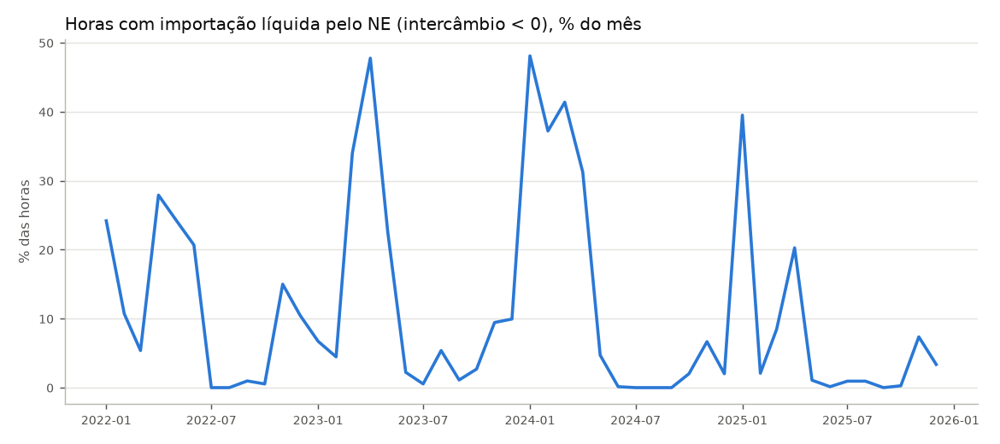

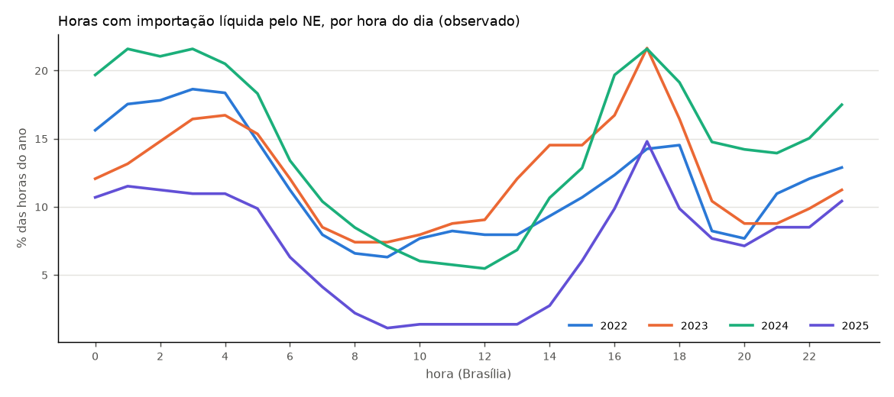

### 4.6 Clima de longo prazo

**Os anos com dados ficam abaixo da média de vento.** Pelo CF eólico que a frota atual teria em cada ano
da série ERA5 de 1995–2025 (Figura 15), 2022 é o 4º ano menos ventoso de 31,
2024 o 8º e 2023 o 14º; 2025 é o 22º. A média
de 2022–2025 é 0,448, contra 0,460 nos 31 anos.
- **Variação entre anos.** O CF eólico potencial que a frota atual teria em cada ano varia de
  0,39 (2009) a 0,52 (2012).
- **Risco.** Calibrar só em 2022–2025 subestimaria anos ventosos e não mostraria anos muito fracos.
- **Consequência.** Por isso o Monte Carlo usa os 31 anos.

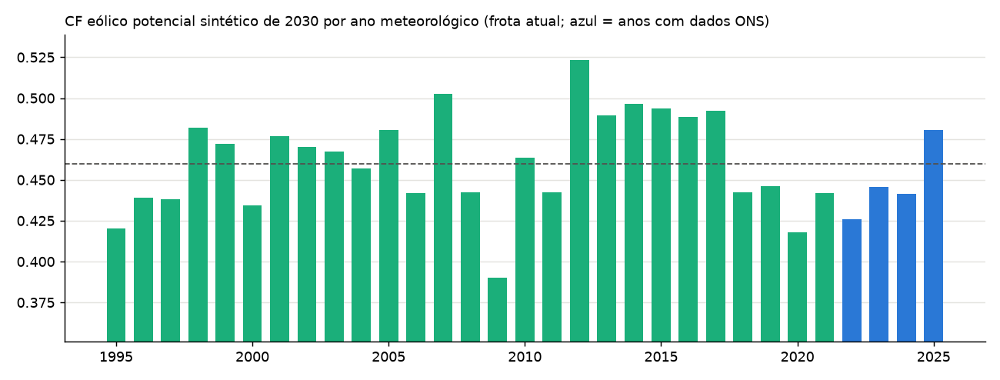

### 4.7 Data centers: da pesquisa documental aos cenários

**O PDE 2035 não serve para os cenários de data centers.** A pergunta exige saber quanta carga de data
centers entra no NE. O PDE 2035, na carga de referência, embute data centers, mas não os separa por
subsistema nem por ano.

**A fonte usada: a previsão de carga do PLAN 2026–2030 (ONS/EPE/CCEE).** Ela publica a carga de data
centers de Rede Básica por subsistema. O critério soma 100% dos acessos com contrato assinado e 50% dos
que têm parecer favorável.
- **Revisões.** Para o NE em 2030, a projeção passou de 716 MWmed (PLAN,
  nov/2025) para 1.291 (1ª RQ, mar/2026) e
  2.098 MWmed (2ª RQ, jul/2026), dos quais
  1.886 já contratados (Figura 16).
- **Inventário.** Paralelamente, montamos um inventário documental de 17 projetos (portarias
  do MME, ANEEL, imprensa setorial), com a definição de potência de cada fonte e um grau de maturidade
  (M0 a M3).
- **Peso do principal projeto.** O maior projeto com obra iniciada (Pecém fase 1) tem ~300 MW de consumo
  previsto a partir de 2027.

**Decisões tomadas com o usuário.**
- **Caso-base.** Carga do PLAN sem os data centers de Rede Básica: 18.278 − 2.098 = 16.180 MWmed.
- **Cenários de data centers.** Conservador (só contratos), central (2ª RQ) e alto (contratos + 100% dos
  pareceres + anúncios com MW). O PDE ficou como sensibilidade.

Como a projeção oficial já é "MWmed de carga na rede", não se aplica PUE (eficiência do data center) sobre
ela; PUE e utilização só entram para os itens do inventário.

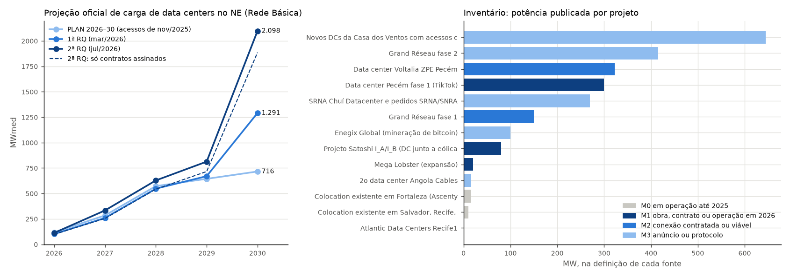

## 5. Modelos implementados

### 5.1 O algoritmo: HistGradientBoosting (HGB)

Todos os modelos de *machine learning* usam o `HistGradientBoostingRegressor` (e o classificador
equivalente) do scikit-learn.

**Como funciona.**
- É um *gradient boosting* de árvores de decisão: o modelo é uma soma de muitas árvores pequenas, cada
  uma ajustada para corrigir o erro das anteriores.
- A versão "Hist" agrupa cada feature em até 255 faixas (histogramas), o que torna o treino rápido mesmo
  com dezenas de milhares de horas.

**Por que foi escolhido.**
- Captura relações não lineares (a curva de potência eólica é em forma de S) e interações (hora × mês)
  sem que seja preciso especificá-las.
- Não exige normalização das variáveis.
- Lida bem com tabelas de algumas dezenas de features.
- É o tipo de modelo recomendado pelo plano do projeto ("um modelo principal de árvores").
- Redes neurais (LSTM, MLP) ficaram fora do escopo obrigatório.

**Hiperparâmetros.** Fixos, sem busca, para evitar ajuste fino à amostra de teste: 400 iterações, taxa de
aprendizado 0,05, até 31 folhas por árvore, ≥ 40 amostras por folha, regularização L2 = 1, parada
antecipada automática e semente 20261111.

**Baselines.** Todo modelo é comparado a baselines ingênuos que qualquer operador usaria:
- *sazonal semanal:* o valor da mesma hora uma semana antes;
- *persistência:* o valor h horas antes;
- *perfil climatológico:* a média por mês e hora.

Só se considera que o modelo funciona quando ele supera o baseline de forma consistente.

### 5.2 Catálogo de modelos

Os modelos têm três papéis, conforme o acordo do projeto: (1) **validação acadêmica** de previsão de
curto prazo; (2) **função de transferência** clima → sistema, que gera os perfis de 2030; (3)
**classificação de cortes**. Nenhum modelo projeta 2030 por recursão hora a hora, o que acumularia erro.

| Modelo | Papel | Alvo (saída) | Features (entradas) | Treino | Validação | Saída | Onde é usado |
|---|---|---|---|---|---|---|---|
| A (h = 1 h, 24 h) | validação: previsão de curto prazo | carga líquida horária (MWmed) | calendário, temperatura, temp. aparente, umidade, CDH, irradiância, lags do alvo (≥ h) e médias móveis | toda a história antes do mês testado | 12 dobras mensais em 2025 | previsão da carga | só validação acadêmica |
| B (h = 1 h, 24 h) | validação | CF eólico potencial | hora, mês, dia do ano, vento e vento³ a 100 m, lags e médias móveis | idem | idem | previsão do CF | só validação |
| C (h = 1 h, 24 h) | validação | CF solar observado | hora, mês, dia do ano, irradiância, temperatura, lags | idem | idem | previsão do CF | só validação |
| A0 | função de transferência | carga bruta / média do ano | calendário completo + temperatura, temp. aparente, umidade, CDH, irradiância (sem lags) | 2022–2025 | deixando um ano de fora | forma horária da carga | perfis de 2030 (Monte Carlo) |
| E0 | função de transferência | MMGD / média móvel de 365 dias | hora, mês, dia do ano, irradiância nas capitais e nos polos, temperatura | 2022-01 → 2026-10 | resíduos fora da amostra | forma horária da MMGD | perfis de 2030 |
| B0 | função de transferência | CF eólico potencial | hora, mês, dia do ano, vento e vento³ a 100 m (pesos da frota atual) | 2024-07 → 2026-10 (frota recente) | temporal: 2025 e 2026 fora do treino | CF eólico horário | perfis de 2030; fator de frota do determinístico |
| C0 | função de transferência | CF solar potencial | hora, mês, dia do ano, irradiância nos polos, temperatura | 2024-07 → 2026-10 | temporal | CF solar horário | perfis de 2030; fator de frota |
| D | classificador (viabilidade) | hora com corte > 1% da capacidade, por motivo | potencial eólico e solar, carga, MMGD, excedente bruto previsto, capacidades, calendário | 2023–2024 e 2024-07 → 2025 | temporal: 2025 e 2026 | probabilidade de corte | só descritivo (não entra no simulador) |

### 5.3 Previsão de curto prazo (validação acadêmica)

**Objetivo.** Mostrar que as relações entre clima, calendário, carga e geração foram de fato capturadas.

**Desenho.**
- Para cada hora de 2025, prevemos o valor 1 hora e 24 horas à frente usando só informação disponível
  no momento da previsão: lags do alvo de pelo menos h horas e médias móveis que terminam na origem.
- O backtesting é de origem móvel: 12 dobras mensais, cada uma treinada com todo o histórico anterior ao
  mês testado.
- O clima do instante-alvo é o observado (ERA5), equivalente a uma previsão meteorológica perfeita. Por
  isso o desempenho é um **limite superior** do que se obteria em operação.

| Alvo | h | MAE HGB | Melhor baseline (MAE) | Ganho | Meses em que vence |
|---|---|---|---|---|---|
| A_carga_liquida | 1 | 139 | sazonal_semanal (468) | 70% | 12/12 |
| A_carga_liquida | 24 | 299 | sazonal_semanal (468) | 36% | 11/12 |
| B_cf_eolico_pot | 1 | 0,015 | persistencia_1h (0,025) | 41% | 12/12 |
| B_cf_eolico_pot | 24 | 0,044 | persistencia_24h (0,082) | 47% | 12/12 |
| C_cf_solar | 1 | 0,018 | sazonal_diario (0,048) | 62% | 12/12 |
| C_cf_solar | 24 | 0,042 | persistencia_24h (0,048) | 13% | 10/12 |

**Resultado.**
- O HGB vence o melhor baseline em 10 a 12 dos 12 meses para todos os alvos (Figura 17).
- O ganho é grande para carga e eólica e pequeno (13%) para a solar a 24 h. Para a solar, a persistência
  de 24 h já é muito boa, porque o sol de hoje se parece com o de ontem.
- A Figura 18 mostra uma semana típica.

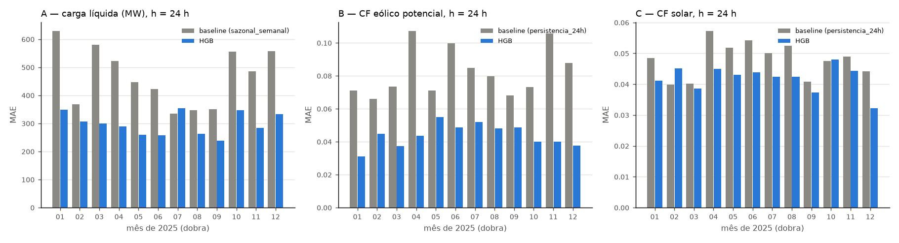

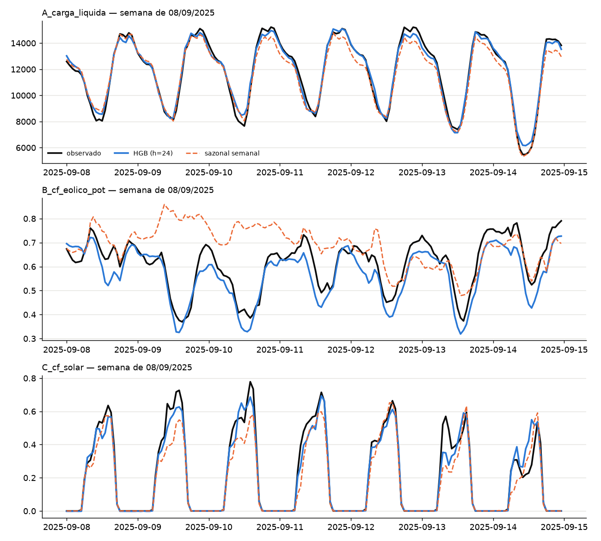

### 5.4 Funções de transferência clima → sistema (o coração da projeção)

**Por que são necessárias.** Para 2030 não temos carga nem geração observadas. A estratégia é:
1. Aprender, nos dados de 2022–2026, como o clima e o calendário determinam a **forma** horária de cada
   série.
2. Aplicar esse aprendizado ao clima de cada um dos 31 anos meteorológicos (1995–2025), dispostos no
   calendário de 2030.
3. Multiplicar a forma pelo **nível** de 2030 dado pelos cenários (carga e MMGD do PLAN, capacidades do
   SIGA/PDE).

Esses modelos não usam lags do alvo, porque em 2030 não há "valor da hora anterior" observado.

**As quatro funções.**
- **A0 — forma da carga bruta** (carga ÷ média do ano). Validada deixando um ano inteiro de fora: MAE
  de 2,6–3,2% contra 2,8–3,9% do
  perfil médio. Vence nos 4 anos.
  - Com a carga *líquida* o erro chegaria a 9,4%, porque a forma muda com a MMGD. Isso
    confirmou a decisão da seção 4.3.
- **E0 — forma da MMGD** (MMGD ÷ média móvel de 365 dias, o que remove o crescimento da capacidade).
  Depende da irradiância.
- **B0 — CF eólico potencial.** Treinado só na frota recente (2024-07 a 2025-12) e testado em 2026: MAE
  0,044 contra 0,133 do perfil
  médio, com viés de -0,014.
  - Treinado em 2022–2024 e testado em 2025, o viés seria de -0,033,
    efeito da frota nova. Isso justifica a janela recente.
- **C0 — CF solar potencial.** MAE 0,024–0,027
  contra 0,028–0,035 do perfil.

**O que os modelos usam.** A importância por permutação mede quanto o erro aumenta quando uma feature é
embaralhada (Figura 19).
- **B0:** o vento a 100 m domina, seguido da hora do dia, que corrige o ciclo noturno subestimado pelo
  ERA5.
- **A0:** hora, dia da semana e dia do ano dominam. A temperatura aparece com peso menor porque divide a
  informação sazonal com o dia do ano.

Importância por permutação **não** tem interpretação causal.

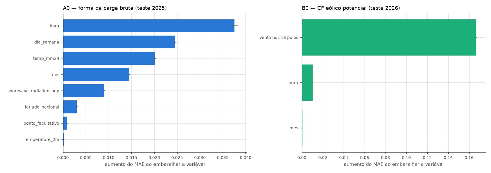

A Figura 20 mostra as previsões fora do treino. A carga acompanha o ciclo diário e semanal, com erros
maiores nos domingos, quando o modelo prevê uma queda menor que a observada. O CF eólico diário segue as
variações do vento ao longo de 2026.

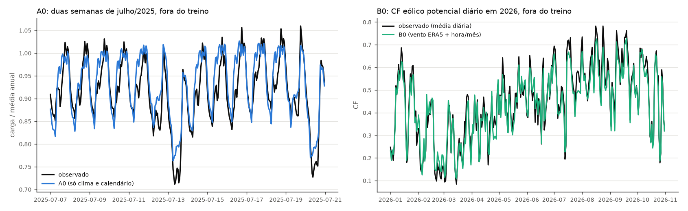

**Da previsão ao perfil sintético.**
- **Calendário e clima.** O clima de cada ano é colocado no calendário de 2030 por (mês, dia, hora); 29/02
  é descartado. O clima usa **pesos fixos** da frota de out/2026, para que todos os anos representem a
  mesma população de usinas.
- **Variabilidade.** Como as previsões são médias condicionais, mais "lisas" que a realidade, a
  variabilidade que falta é recomposta com **resíduos fora da amostra**: erros de previsão medidos por
  validação cruzada mensal na janela 2024-07..2025-12, reamostrados no Monte Carlo (seção 7).
- **Validação.**
  - O CF eólico sintético tem correlação horária de 0,96–0,98
    com o observado.
  - Com os resíduos, o desvio-padrão horário reproduz o observado (0,184
    contra 0,183 em 2025).
  - Só 0,15% das horas de 1995–2021 ficam fora da
    faixa de treino de alguma variável, ou seja, quase não há extrapolação.

### 5.5 Classificador de cortes (Modelo D)

**Pergunta.** É possível prever, com informação disponível antes, as horas em que haverá corte eólico?

**Desenho.**
- Rótulo: hora com corte > 1% da capacidade, separado por motivo.
- Features: só variáveis ex-ante (potencial previsto, carga, MMGD, excedente bruto previsto, capacidades,
  calendário). Nunca o intercâmbio ou o despacho do mesmo instante.

**Resultados.**
- **Ordenação boa.** Para o corte energético, ROC-AUC de 0,91–0,93
  e PR-AUC de 0,77–0,85,
  contra 0,25–0,32
  ao acaso.
- **Calibração instável.** A frequência de horas com corte subiu de 7%
  (2022) para 69% (2025) (Figura 21). Um modelo treinado até 2024
  superestima as probabilidades de 2025, e um treinado até 2025 subestima as de 2026.
- **REL não é previsível.** O corte por indisponibilidade elétrica externa depende de eventos de rede que
  essas features não captam.

**Decisão.** O classificador fica como análise descritiva e **não** é usado para projetar probabilidades
de corte em 2030. É uma redução de escopo registrada, coerente com a regra de não aplicar modelos sob
mudança de regime.

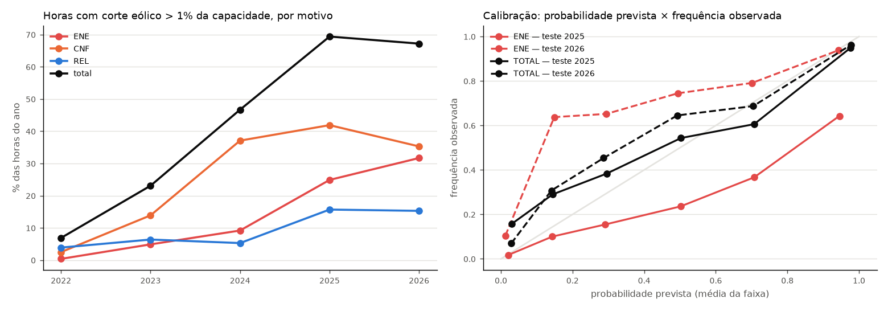

## 6. O simulador do balanço horário de 2030

### 6.1 O que é e como foi construído

O simulador é uma "contabilidade" hora a hora do NE em 2030 (8.760 horas). Para cada hora ele soma a
geração de cada fonte, subtrai a carga e a carga de data centers e registra se sobra (excedente) ou falta
(importação). Cada termo vem de uma etapa anterior:

| Termo do balanço | Como é gerado em 2030 | De onde vem o nível |
|---|---|---|
| Carga bruta L(t) | forma horária (A0 + resíduo) × 16.180 MWmed | 2ª RQ do PLAN: 18.278 menos 2.098 de DC |
| MMGD(t) | forma horária (E0 + resíduo) × 2.386 MWmed | 2ª RQ do PLAN |
| Eólica(t) | CF (B0 + resíduo) × capacidade do cenário | SIGA + PDE: 32,3 / 34,3 / 39,4 GW |
| Solar(t) | CF (C0 + resíduo) × 13,5 GW | SIGA (operação + construção) |
| Hidráulica(t) | regra emulada: energia diária do ano hidrológico sorteado + resposta intradiária à carga líquida | balanço ONS 2022–2025 |
| Térmica(t) | série horária do ano hidrológico sorteado | balanço ONS 2022–2025 |
| L_DC | constante (flat) no ano | 2ª RQ do PLAN e inventário |
| M(t) | Hidr + Térm + Eól + Sol + MMGD − (L + L_DC) | importação = max(0, −M); excedente = max(0, M) |

Os cenários combinam três eixos de data centers × eólica:

| Dimensão | Cenário | Valor em 2030 | Definição |
|---|---|---|---|
| Data centers | sem_dc | 0 | contrafactual sem nenhum data center de Rede Básica (inclusive os que entram desde 2026) |
|  | conservador | 1.886 MWmed | só contratos assinados (2ª RQ) |
|  | central | 2.098 MWmed | 2ª RQ do PLAN: 100% contratos + 50% pareceres favoráveis |
|  | alto | 2.753 MWmed | contratos + 100% dos pareceres + anúncios com MW (em rampa) |
| Eólica | baixa | 32,3 GW | só usinas em operação (SIGA) |
|  | base | 34,3 GW | operação + construção |
|  | alta | 39,4 GW | base + expansão indicativa do PDE até 2030, alocada ao NE |
| Solar | única | 13,5 GW | operação + construção |
| Carga (sem DC) | única | 16.180 MWmed | 2ª RQ do PLAN; PDE como sensibilidade |
| MMGD | única | 2.386 MWmed | 2ª RQ do PLAN; faixa 1.939–2.718 como sensibilidade |
| Intercâmbio | — | exportação ≤ 21 GW | PDE 2035; importação sem limite documentado (6/8/10 GW em sensibilidade) |

**Métricas por ano simulado.**
- importação anual (TWh) e horas com importação;
- P95 horário e pico da importação (MW);
- maior sequência de horas importando;
- excedente e excedente acima do limite de exportação;
- horas com importação acima de 6/8/10 GW.

**Compensação eólica.** O simulador também calcula quanta capacidade eólica adicional (ΔW) compensa os
data centers, por quatro critérios:
1. **energia anual:** L_DC ÷ CF médio;
2. **importação anual** igual à do caso sem data centers;
3. **horas de importação** iguais;
4. **P95 horário** igual.

A busca é feita por bisseção, porque a importação diminui de forma monótona com ΔW.

### 6.2 Versão determinística (4 anos observados)

**Construção.** A primeira versão usa os perfis *observados* de 2022–2025 como quatro "anos climáticos":
- a forma é a de cada ano, escalada aos níveis de 2030;
- o CF eólico e o solar são corrigidos pelo fator de frota;
- a hidráulica e a térmica repetem o despacho histórico daquele ano.

Serve de verificação simples e transparente (Figura 22).

**Testes-limite automatizados.**
- carga de data centers zero reproduz o caso-base;
- mais carga nunca reduz a importação;
- MW × h fecha com MWh;
- a compensação encontrada devolve a importação ao caso-base.

| DC | Importação, eólica base (TWh) | Horas, eólica base | Eólica baixa (TWh) | Eólica alta (TWh) |
|---|---|---|---|---|
| sem_dc | 2,9 | 883 | 3,3 | 2,2 |
| conservador | 5,0 | 1.326 | 5,7 | 3,7 |
| central | 5,3 | 1.388 | 6,1 | 3,9 |
| alto | 6,3 | 1.570 | 7,2 | 4,6 |

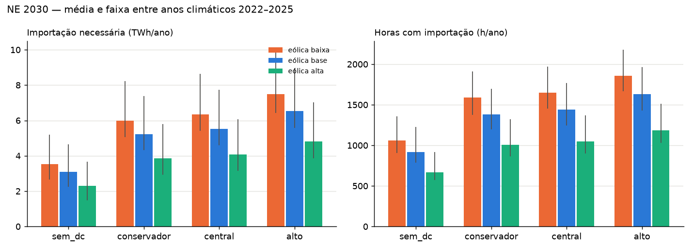

### 6.3 Por que não parar no determinístico

A versão determinística tem três limitações:
- só 4 anos climáticos, justamente anos pouco ventosos (seção 4.6);
- nenhuma medida de incerteza;
- extremos (picos, P95) mal representados.

Daí o Monte Carlo.

## 7. Monte Carlo

### 7.1 Propósito

O Monte Carlo transforma "um resultado por cenário" em uma **distribuição condicional** de resultados.
Ele responde perguntas como:
- quão diferente pode ser 2030 conforme o clima do ano;
- o efeito dos data centers aparece sempre ou só em anos ruins;
- quão estável é a estimativa.

A incerteza amostrada é **climática e operacional**. As escolhas de cenário (quantos data centers, quanta
eólica) ficam como eixos separados, porque não são aleatórias: são hipóteses de política e de mercado.

### 7.2 Como é feito um sorteio

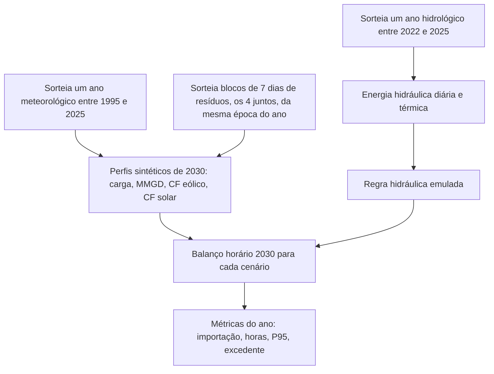

**Componentes do sorteio.**
- **Ano meteorológico** (31 opções): define os perfis sintéticos gerados pelas funções de transferência.
- **Resíduos em blocos.** Sequências de 7 dias de erros fora da amostra das quatro séries, sorteadas
  **juntas** e de épocas do ano parecidas (±14 dias). Isso preserva a autocorrelação e a dependência
  entre carga, vento e sol (por exemplo, um dia nublado reduz a solar e a MMGD ao mesmo tempo). O tamanho
  do bloco foi testado: 3 e 14 dias dão o mesmo resultado.
- **Resíduos recentrados.** Os erros fora da amostra não têm média zero. De cada série subtrai-se a média
  esperada sob o próprio sorteio (CF eólico -0,0055; CF solar -0,0042; carga
  +0,0019; MMGD -0,0042), e as formas de carga e MMGD voltam a ter média 1 em cada
  sorteio. Os resíduos repõem variabilidade horária sem deslocar o nível anual. Sem essa correção a
  importação média seria +0,38 TWh diferente.
- **Ano hidrológico** (2022–2025): define a energia hidráulica diária e a térmica.
- **Números aleatórios comuns.** O mesmo sorteio é aplicado a todos os cenários, de modo que as diferenças
  entre cenários são **pareadas**: medem o efeito do cenário no mesmo clima.

**Regra hidráulica emulada (decisão do usuário).**
- **Por que.** O despacho horário da hidráulica do NE responde às variações intradiárias da carga líquida
  (correlação ~0,7). Repetir o despacho de um ano qualquer, sem essa resposta, quebraria a dependência
  entre clima e despacho.
- **Como.** A regra mantém a energia diária do ano hidrológico sorteado e redistribui a geração dentro do
  dia seguindo a carga líquida simulada, com o coeficiente medido em cada ano
  (0,17–0,42), dentro dos mínimos e máximos mensais históricos (Figura 23). O
  coeficiente é estimado sobre a carga líquida potencial (geração + corte), a mesma grandeza a que a regra
  é aplicada (decisão 52, adotada em 2026-11-17). Antes era estimado sobre a carga já cortada; a seção 7.5
  mostra por que isso era inconsistente.
- **Sensibilidades.** As alternativas (despacho histórico sem resposta, hidráulica plana) aparecem como
  sensibilidades.

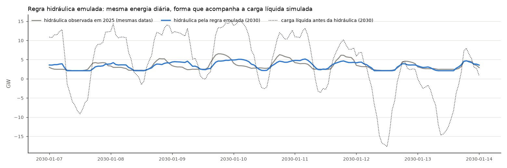

**Perfil horário da hidráulica emulada.** A Figura 24 mostra a média por hora do dia: à esquerda, os
sorteios de 2030; à direita, a regra aplicada às parcelas observadas de 2026, o que isola o efeito da regra.
- A regra conserva a energia de cada dia, mas a distribui como a carga líquida **potencial**, que é alta a
  noite inteira e baixa ao meio-dia. Em 2030 (jan–abr), a hidráulica emulada fica em
  5,1 GW de 0 h a 5 h, contra 4,0 GW no
  despacho observado dos anos hidrológicos, e em 2,6 GW de 8 h a 14 h,
  contra 3,5 GW.
- O despacho real concentra a hidráulica no início da noite. Em 2026 (jan–abr), de 18 h a 21 h, a hidráulica
  observada foi de 6,0 GW; a regra entrega
  4,7 GW com o coeficiente adotado e
  5,2 GW com o anterior (seção 7.5).
- O coeficiente adotado (decisão 52) responde menos que o anterior nos anos de corte alto.
- A regra é uma resposta linear, sem otimização; a forma do despacho real reflete também decisões do SIN
  e restrições que o simulador não tem.

A Figura 25 mostra uma semana de 2030 decomposta, extraída de um sorteio com importação próxima da
mediana: a eólica sustenta a noite, a solar e a MMGD sustentam o dia, e a importação (hachurada) aparece
no fim da tarde e em noites de pouco vento.

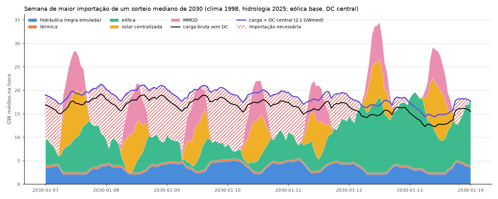

### 7.3 Convergência

Foram usados 2.000 sorteios (semente 20261112). De 1.500 para 2.000 sorteios, a média
da importação anual mudou 0,24% e o P95,
0,49% (Figura 26).

| Sorteios | Média (TWh) | P95 (TWh) |
|---|---|---|
| 100 | 5,112 | 8,141 |
| 250 | 5,233 | 8,863 |
| 500 | 5,211 | 9,364 |
| 1.000 | 5,183 | 9,551 |
| 1.500 | 5,168 | 9,564 |
| 2.000 | 5,181 | 9,611 |

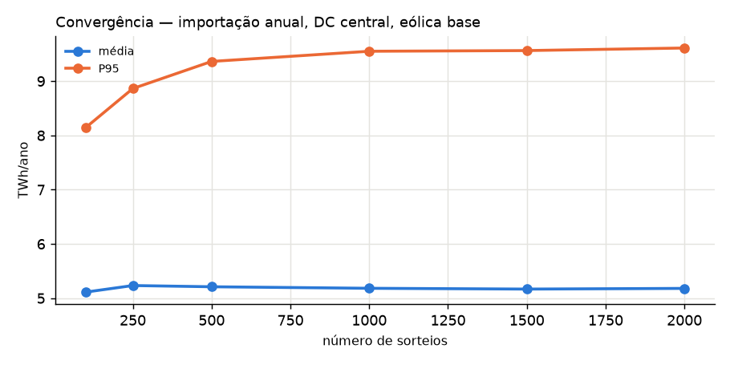

### 7.4 Validação retrospectiva: o simulador reproduz o passado?

**Teste.** Antes de usar o simulador para 2030, ele foi rodado para cada ano de 2022–2025 com o clima, o
ano hidrotérmico e os **níveis observados** daquele ano (carga coerente com o balanço, MMGD, energia
eólica e solar potenciais). Só os resíduos são sorteados (300 sorteios). Se as formas horárias e a
regra hidráulica estiverem certas, a importação simulada deve ficar próxima da observada (Figura 27).

| Ano | Importação observada (TWh) | Simulada, regra emulada (erro) | Simulada, despacho hidráulico observado (erro) | Pico observado (GW) | Pico simulado, regra (GW) | Pico simulado, despacho observado (GW) | Corte eólico em horas de importação (TWh) |
|---|---|---|---|---|---|---|---|
| 2022 | 1,47 | 1,55 (+5%) | 1,99 (+35%) | 7,1 | 6,0 | 7,1 | 0,00 |
| 2023 | 2,39 | 2,58 (+8%) | 2,84 (+19%) | 7,2 | 7,3 | 8,3 | 0,07 |
| 2024 | 3,32 | 2,73 (-18%) | 2,99 (-10%) | 7,6 | 7,5 | 8,9 | 0,02 |
| 2025 | 1,58 | 1,27 (-20%) | 1,32 (-17%) | 7,9 | 7,9 | 8,8 | 0,37 |

- **Erro da importação anual.** Com a regra emulada (caso central), de
  -20% a +8%, erro absoluto médio de
  13%. Com o despacho hidráulico observado no próprio ano, de
  -17% a +35%, erro absoluto médio de
  20%. Nenhuma convenção é melhor em todos os anos.
- **O erro muda ao longo dos anos.** Com a regra, vai de +5% em 2022 a
  -20% em 2025.
  - Em 2025, 0,37 TWh de corte eólico
    ocorreram em horas de importação (restrições de rede). O simulador usa a geração potencial e não
    representa esses cortes.
  - Em 2024 esse corte foi de 0,02 TWh,
    então a subestimação daquele ano tem outra origem. A seção 7.5 a atribui ao coeficiente da regra
    hidráulica e, principalmente, à forma da eólica simulada.
- **Picos.** Com a regra, o pico simulado difere do observado em -1,1 a
  +0,1 GW.
- **Leitura.** O nível absoluto da importação de 2030 carrega um erro estrutural dessa ordem, comparável
  ao efeito de trocar a convenção hidráulica. As diferenças pareadas entre cenários usam o mesmo sorteio
  nos dois lados e variam menos (seção 8.6).

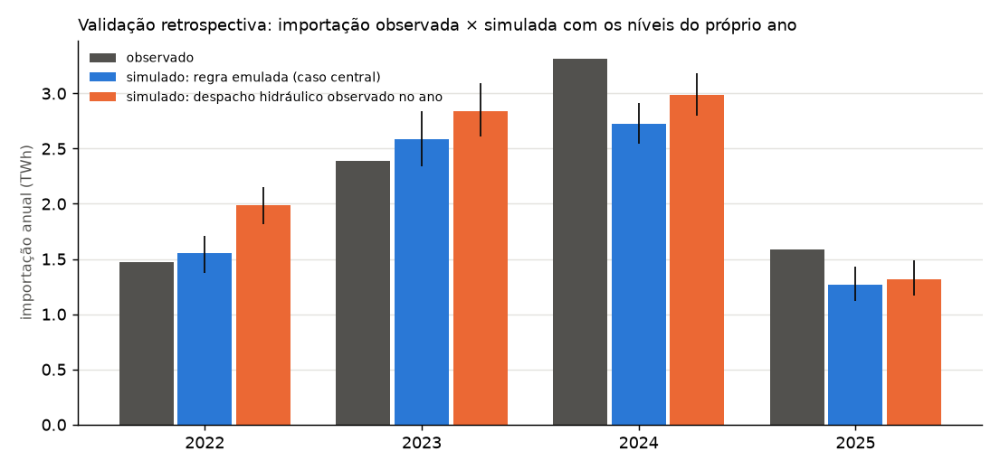

### 7.5 Backtest de 2026 e diagnóstico da subestimação

**Teste.** O simulador recebe os níveis de cenário de 2026 (anexo; DC central, porque a carga do PLAN de
2026 inclui os data centers da 2ª RQ) e é comparado ao balanço observado de janeiro a outubro, só nas
6.418 das 7.296 horas em que o balanço do ONS fecha (decisão 16).
O observado "potencial" soma ao intercâmbio os cortes eólicos e solares, que é o conceito do simulador.
- **(A) ex-ante.** Os 2.000 sorteios do Monte Carlo de 2026 (clima 1995–2025,
  hidrologia 2022–2025): o ano observado cai dentro da faixa?
- **(B) clima e hidrologia conhecidos.** As funções de transferência são re-treinadas só com dados até
  2025-12-31 (fora da amostra) e aplicadas ao ERA5 de 2026. A térmica é a observada e a hidráulica segue a
  energia diária observada de 2026, pela regra emulada (coeficiente adotado e, para comparação, o anterior)
  ou pelo despacho real. Os níveis continuam sendo os do cenário.

| Métrica (jan–out, horas válidas) | Observado: intercâmbio | Observado: potencial (+ cortes) | A: mediana [P5–P95] | B: regra (caso central) | B: regra, beta anterior | B: despacho hidráulico observado |
|---|---|---|---|---|---|---|
| Importação (TWh) | 1,68 | 1,67 | 0,98 [0,21–2,90] | 1,13 | 0,90 | 1,25 |
| Horas com importação | 547 | 524 | 393 [114–822] | 529 | 464 | 498 |
| P95 da importação horária (MW) | 2.308 | 2.305 | 675 [0–4.108] | 1.446 | 1.007 | 1.425 |
| Pico de importação (MW) | 8.048 | 8.048 | 8.301 [5.055–10.335] | 7.415 | 6.600 | 9.062 |
| Excedente (TWh) | 43,0 | 68,9 | 70,5 [60,6–82,3] | 63,3 | 63,1 | 63,4 |

- **A contém o ano observado.** A importação de 1,68 TWh fica no percentil
  74 da distribuição ex-ante (P5–P95 0,21–2,90 TWh).
- **B subestima.** Com o clima e a hidrologia de 2026, o simulador dá 1,13 TWh com a regra
  do caso central (-33%). A forma horária de M é boa: correlação
  0,96 e sinal certo em 97% das horas. Os extremos ficam curtos: o P95 da
  importação horária simulada é 63%
  do observado.
- **Não é o nível médio.** O M médio de B fica 753 MW abaixo do observado, o que aumentaria
  a importação. A decomposição abaixo fecha esse viés; a parcela "carga: balanço × API" é a diferença entre
  os dois conceitos de carga (decisão 41).

| Parcela | Observado (MWmed) | Simulado B (MWmed) | Efeito em M (MWmed) |
|---|---|---|---|
| carga bruta (com DC) | 14.303 | 14.001 | +302 |
| MMGD | 1.821 | 1.696 | -125 |
| eólica potencial | 14.852 | 14.345 | -507 |
| solar potencial | 3.118 | 3.119 | +2 |
| hidráulica | 3.917 | 3.912 | -6 |
| térmica | 649 | 649 | 0 |
| carga: balanço do ONS × API (decisão 41) | — | — | -419 |
| total = viés médio de M (B − observado) | — | — | -753 |

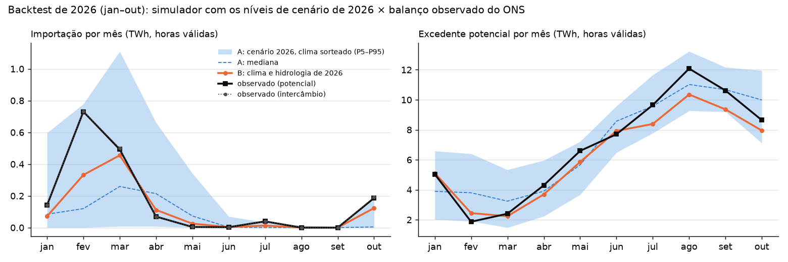

**Esperado ou erro de metodologia?** Três testes (`src/sim/diagnostico_importacao.py`) separam as causas.

**1. Inconsistência no coeficiente da regra hidráulica: erro de método, corrigido (decisão 52).**
- **O problema.** O coeficiente beta era estimado sobre a carga líquida **realizada**, com a eólica e a
  solar já cortadas. A regra, porém, é aplicada à carga líquida **potencial** do simulador, que não tem
  corte. Com corte alto, a carga líquida potencial oscila muito mais dentro do dia. Multiplicar essa
  oscilação maior por um beta medido na oscilação menor exagera a resposta: a hidráulica vai demais para
  as horas de carga líquida alta, e a importação cai.
- **A correção.** Desde 2026-11-17 o caso central usa o beta estimado sobre a grandeza a que é aplicado,
  a carga líquida potencial (adotado). Ele fica próximo do anterior em 2022 e bem menor a partir de 2024:

| Ano | Corte eólico (%) | Beta anterior (carga líquida realizada) | Beta adotado (carga líquida potencial) | Desvio intradiário, realizada (MW) | Desvio intradiário, potencial (MW) |
|---|---|---|---|---|---|
| 2022 | 0,6 | 0,43 | 0,42 | 1.815 | 1.893 |
| 2023 | 3,9 | 0,35 | 0,32 | 2.135 | 2.321 |
| 2024 | 9,1 | 0,37 | 0,27 | 2.615 | 3.453 |
| 2025 | 20,1 | 0,27 | 0,17 | 2.598 | 4.621 |
| 2026 | 21,1 | 0,37 | 0,21 | 3.151 | 5.921 |

- **Validação retrospectiva com os dois coeficientes** (mesmos sorteios da seção 7.4):

| Ano | Observado (TWh) | Beta anterior (erro) | Beta adotado (erro) |
|---|---|---|---|
| 2022 | 1,47 | 1,53 (+4%) | 1,55 (+5%) |
| 2023 | 2,39 | 2,55 (+7%) | 2,58 (+8%) |
| 2024 | 3,32 | 2,51 (-24%) | 2,73 (-18%) |
| 2025 | 1,58 | 1,11 (-30%) | 1,27 (-20%) |

- **Efeito no backtest de 2026.** B passa de 0,90 TWh (beta anterior) para 1,13 TWh
  (despacho observado: 1,25 TWh).
- **Com as formas observadas, a regra corrigida acerta.** Aplicada às parcelas observadas, a regra com o
  beta adotado erra a importação em -7% a
  -1% em 2024–2026. Com o beta
  anterior, errava -19% a
  -8%.

**2. Formas horárias: a eólica simulada tem poucas horas de pouco vento. É sistemático nos anos recentes.**
Com os **níveis observados** de cada ano, a forma simulada de cada parcela é trocada pela observada.
As funções de transferência foram re-treinadas sem o próprio ano. A tabela mostra a importação e o erro.

| Importação (TWh, erro) | 2022 | 2023 | 2024 | 2025 | 2026 |
|---|---|---|---|---|---|
| Observado (geração potencial) | 1,62 | 2,53 | 3,52 | 1,64 | 1,73 |
| Método atual (formas simuladas + resíduos, beta adotado) | 1,44 (-11%) | 2,65 (+5%) | 3,06 (-13%) | 1,12 (-32%) | 0,95 (-45%) |
| Método anterior (formas simuladas + resíduos, beta anterior) | 1,42 (-13%) | 2,61 (+3%) | 2,84 (-19%) | 0,96 (-41%) | 0,74 (-57%) |
| Formas simuladas sem resíduos, beta adotado | 1,27 (-22%) | 2,19 (-13%) | 2,99 (-15%) | 1,05 (-36%) | 0,94 (-46%) |
| … só a forma eólica observada | 1,11 (-32%) | 2,29 (-10%) | 3,26 (-7%) | 1,33 (-19%) | 1,44 (-17%) |
| … só a forma da carga observada | 1,39 (-14%) | 2,15 (-15%) | 2,87 (-18%) | 1,24 (-24%) | 1,06 (-39%) |
| … só as formas solar e MMGD observadas | 1,37 (-15%) | 2,32 (-8%) | 3,22 (-8%) | 1,10 (-33%) | 1,00 (-42%) |
| Todas as formas observadas, beta anterior | 1,37 (-16%) | 2,30 (-9%) | 3,25 (-8%) | 1,47 (-10%) | 1,40 (-19%) |
| Todas as formas observadas, beta adotado | 1,39 (-15%) | 2,34 (-8%) | 3,41 (-3%) | 1,63 (-1%) | 1,61 (-7%) |
| Formas simuladas sem resíduos, despacho hidráulico observado | 1,62 (-1%) | 2,36 (-7%) | 3,19 (-9%) | 1,10 (-33%) | 1,07 (-39%) |
| Erro da eólica simulada no quintil de menos vento (MW) | +74 | +333 | +540 | +800 | +806 |
| P5 horário da eólica: observado / simulado com resíduos (MW) | 3.045 / 2.856 | 3.308 / 3.144 | 2.886 / 3.263 | 4.965 / 5.279 | 4.486 / 4.959 |

- **A eólica é a parcela que mais pesa.** Trocar só a forma eólica pela observada aumenta a importação em
  0,27 a 0,50 TWh em 2024–2026; em 2022 o efeito é
  -0,16 TWh. A forma da carga muda de sinal entre os anos (acaso). As formas solar e MMGD somam
  +0,05 a +0,24 TWh.
- **O erro cresce ano a ano.** Nas horas de menos vento, a eólica simulada superestima a observada em
  +74 MW em 2022 e
  +806 MW em 2026.
- **Os resíduos não corrigem a cauda.** Eles foram desenhados para repor essa variabilidade.
  - Em 2022 e 2023, repõem: +0,16 a +0,46 TWh,
    e o P5 da eólica simulada chega ao observado ou fica abaixo dele.
  - Em 2024–2026, quase nada: +0,00 a +0,07 TWh;
    o P5 simulado continua acima do observado.
  - Os resíduos são sorteados em blocos independentes do tempo meteorológico. Repõem a variância média, mas
    não a frequência de calmarias observada nos anos recentes.
  - A causa exata não foi isolada. Candidatas: os pesos espaciais fixos da frota de out/2026 aplicados ao
    ERA5; a geração potencial reconstruída em anos de corte alto; indisponibilidades que não entram na GNRa.
- **Resultado.** Com o método atual (beta adotado e resíduos), o simulador ainda subestima a importação em
  13% a 45% em 2024–2026. Em
  2022 e 2023, o erro fica entre -11% e +5%.

**3. O que é esperado.**
- Um único ano não testa a distribuição: o observado de 2026 está no percentil 74 de A.
- Cortes por restrição de rede em horas de importação não são representados. Em 2025 somaram
  0,37 TWh.
- A diferença entre os conceitos de carga (API × balanço) muda o nível de M, mas no sentido de aumentar a
  importação simulada.
- O momento exato das calmarias de um ano não é previsível pelo ERA5 com uma função de transferência média.

**Conclusão.**
- **Erro de método (corrigido).** A inconsistência do beta era um erro, e o efeito crescia com o corte.
  Corrigida, a regra reproduz a importação quando recebe as formas observadas.
- **Limitação sistemática (não é erro de código).** A maior parte da subestimação de 2024–2026 vem da
  forma eólica simulada. Ela não representa as horas de pouco vento da frota recente, e os resíduos
  sorteados não corrigem isso. O sinal se repete em três anos seguidos, então não é acaso de 2026.
- **Consequência para 2030.**
  - Com o beta adotado, a importação média (DC central, eólica base) passou de 5,04 TWh
    (versão anterior) para 5,18 TWh. O efeito dos data centers passou de 2,25
    para 2,29 TWh (tabela abaixo; mesmos sorteios).
  - A limitação da forma eólica pesa mais: indica que a importação de 2030 tende a estar **subestimada**.
    Nos anos recentes, com os níveis observados, o déficit foi de 13% a
    45%.
  - O efeito pareado dos data centers também tende a crescer quando há mais horas perto de zero.
  - Essa limitação não foi corrigida; uma correção possível está nos próximos passos (STATUS.md).

| Cenário eólico | Importação, DC central: beta anterior (TWh) | Importação, DC central: beta adotado (TWh) | Efeito dos DC: beta anterior (TWh) | Efeito dos DC: beta adotado (TWh) |
|---|---|---|---|---|
| baixa | 5,76 | 5,91 | 2,56 | 2,60 |
| base | 5,04 | 5,18 | 2,25 | 2,29 |
| alta | 3,71 | 3,83 | 1,69 | 1,71 |

## 8. Resultados

### 8.1 Distribuições de 2030

| DC | L_DC (MWmed) | Importação TWh/ano [P5–P95] | Horas com importação | P95 horário (MW) | Pico (MW) | Excedente (TWh) | Excedente > 21 GW (TWh) |
|---|---|---|---|---|---|---|---|
| sem_dc | 0 | 2,9 [0,8–5,9] | 877 | 2.592 | 10.212 | 93 | 3,4 |
| conservador | 1.886 | 4,9 [1,7–9,2] | 1.275 | 4.404 | 12.098 | 78 | 2,1 |
| central | 2.098 | 5,2 [1,9–9,6] | 1.326 | 4.613 | 12.310 | 76 | 1,9 |
| alto | 2.753 | 6,1 [2,4–11,0] | 1.493 | 5.262 | 12.965 | 72 | 1,6 |

Importação média (TWh/ano) por cenário de data centers × eólica:

| DC \ eólica | baixa (32,3 GW) | base (34,3 GW) | alta (39,4 GW) |
|---|---|---|---|
| sem_dc | 3,3 | 2,9 | 2,1 |
| conservador | 5,6 | 4,9 | 3,6 |
| central | 5,9 | 5,2 | 3,8 |
| alto | 7,0 | 6,1 | 4,5 |

As faixas P5–P95 são largas (Figura 30): o mesmo cenário central pode resultar em
1,9 ou 9,6
TWh conforme o clima e a hidrologia. As curvas de cenários diferentes, porém, ficam claramente separadas.

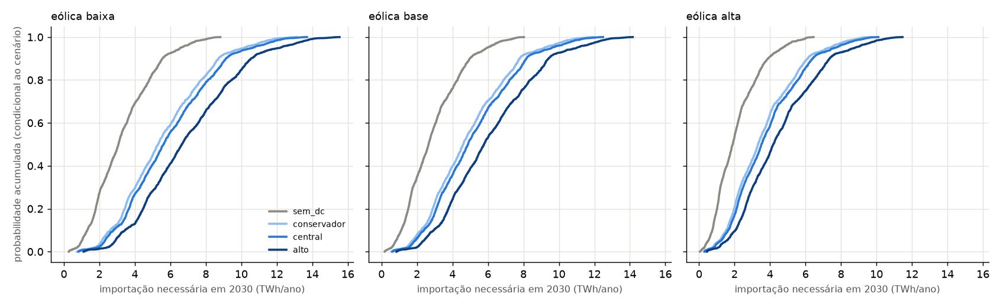

### 8.2 O efeito dos data centers

Comparando cada sorteio consigo mesmo (diferença pareada):

| DC | eólica | Δ importação TWh [P5–P95] | Δ horas com importação |
|---|---|---|---|
| conservador | baixa | 2,3 [1,1–3,6] | 454 |
| conservador | base | 2,0 [0,9–3,3] | 398 |
| conservador | alta | 1,5 [0,6–2,7] | 299 |
| central | baixa | 2,6 [1,3–4,0] | 512 |
| central | base | 2,3 [1,1–3,7] | 449 |
| central | alta | 1,7 [0,7–3,0] | 337 |
| alto | baixa | 3,7 [1,9–5,6] | 704 |
| alto | base | 3,2 [1,5–5,1] | 617 |
| alto | alta | 2,4 [1,0–4,2] | 461 |

- **Sempre positivo.** O efeito é positivo em 100% dos sorteios (Figura 31, esquerda).
- **Depende da eólica.** É maior com eólica baixa: menos vento noturno significa mais horas sem
  cobertura.
- **Peso do clima.** A importação anual por ano meteorológico (Figura 31, direita) varia muito: o ano de
  menos vento (2009) leva a importação central a ~10
  TWh, e o de mais vento (2012), a ~1,3 TWh.
- **Decomposição da variância.** O ano meteorológico explica 73% da variância
  da importação anual; o ano hidrológico, 25%; e os resíduos,
  2%.

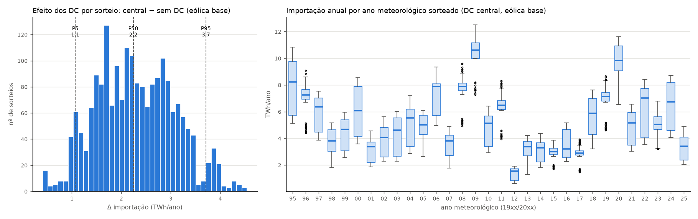

### 8.3 Quando a importação acontece

Em 2030, com o cenário central, a probabilidade de uma hora importar chega a 37% às
18h, contra 25% sem data centers. De madrugada fica em ~20%
e ao meio-dia é praticamente zero (Figura 32). É o padrão histórico da seção 4.5, ampliado: a carga
flat dos data centers "transborda" para as horas em que a geração renovável é menor que a carga.

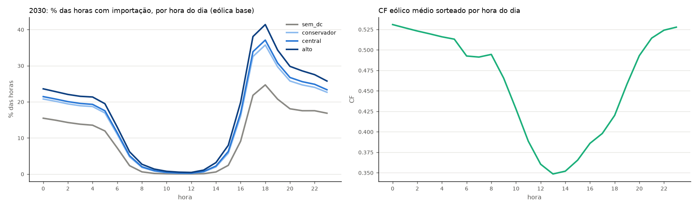

### 8.4 Quanto de eólica compensaria

| DC | eólica | ΔW energia (GW) | ΔW importação anual (GW) [P5–P95] | ΔW horas (GW) | razão | DC em horas de excedente |
|---|---|---|---|---|---|---|
| conservador | baixa | 4,1 | 8,8 [7,3–10,5] | 6,3 | 2,1× | 86% |
| conservador | base | 4,1 | 9,3 [7,7–11,2] | 6,8 | 2,3× | 88% |
| conservador | alta | 4,1 | 10,6 [8,7–12,8] | 7,8 | 2,6× | 91% |
| central | baixa | 4,6 | 9,8 [8,2–11,7] | 7,1 | 2,1× | 86% |
| central | base | 4,6 | 10,4 [8,6–12,5] | 7,5 | 2,3× | 88% |
| central | alta | 4,6 | 11,8 [9,7–14,3] | 8,7 | 2,6× | 91% |
| alto | baixa | 6,0 | 13,1 [10,8–15,7] | 9,4 | 2,2× | 85% |
| alto | base | 6,0 | 13,9 [11,4–16,8] | 10,0 | 2,3× | 87% |
| alto | alta | 6,0 | 15,8 [12,8–19,2] | 11,4 | 2,6× | 90% |

A Figura 33 mostra a curva de importação em função da eólica adicional.
- **Retornos decrescentes.** Cada GW a mais reduz a importação cada vez menos, porque as horas de
  importação que restam são as de vento fraco.
- **Compensação em energia não basta.** Compensar a energia anual
  (4,6 GW) ainda deixa ~4,0 TWh de
  importação, contra 2,9 TWh sem data centers (curva com 300 sorteios comuns).
- **Compensação temporal.** Igualar a importação exige ~10,4 GW.
- **Frota maior, razão maior.** A razão entre os dois critérios fica entre 2,1 e 2,6 e cresce com a frota.

Essa é a resposta quantitativa à regra de "separar compensação energética de compensação temporal".

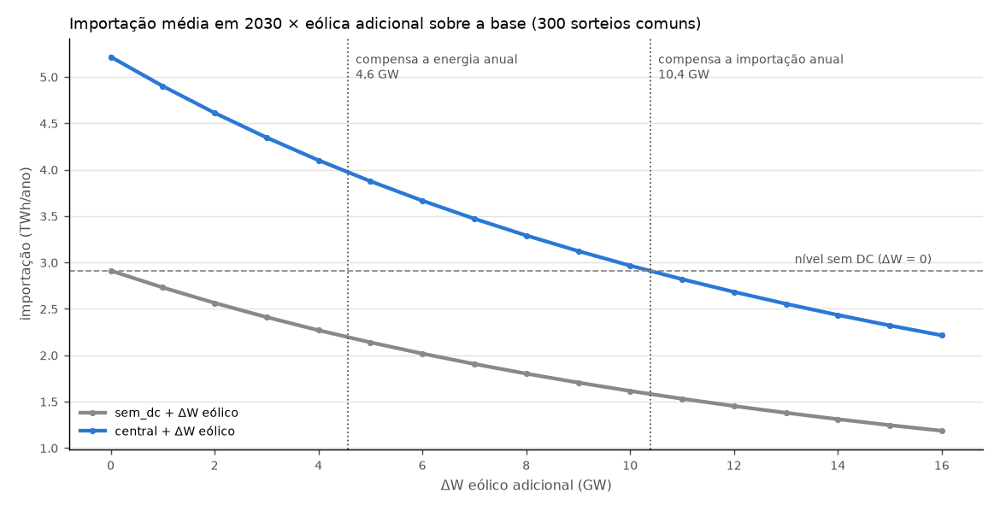

### 8.5 Excedente e limites de intercâmbio

- **Exportação.** O NE segue exportando ~76 TWh/ano no
  cenário central. Os data centers reduzem o excedente acima do limite de exportação de 21 GW de
  3,4 para
  1,9 TWh/ano.
- **Importação.** Não há limite documentado, então reportamos a exposição (horas acima de cada patamar e
  fração dos anos com pelo menos uma hora acima). Não é probabilidade de déficit.

| DC (eólica base) | > 6 GW | > 8 GW | > 10 GW |
|---|---|---|---|
| sem_dc | 136 h / 99% | 41 h / 91% | 7 h / 60% |
| conservador | 293 h / 100% | 129 h / 99% | 37 h / 90% |
| central | 315 h / 100% | 142 h / 99% | 44 h / 92% |
| alto | 388 h / 100% | 190 h / 100% | 69 h / 96% |

**Como ler a tabela.**
- O maior fluxo de importação observado em 2022–2025 foi de 7,9 GW, e
  fluxo não é capacidade.
- Nos níveis históricos, o pico simulado com a regra emulada fica de -1,1 a +0,1 GW do observado (seção 7.4).
- Os picos de 2030 passam desse patamar já sem data centers (10,2
  GW em média). Isso vem do crescimento da carga com a térmica mantida no despacho histórico:
  540–771 MWmed de média anual e máximo horário de
  3,7 GW. O redespacho térmico ou hidráulico que ocorreria nessas horas
  não é representado.
- A tabela mede quanto da necessidade simulada passaria de cada patamar se nada mais respondesse.

### 8.6 Sensibilidades

| Caso (DC central, eólica base) | Importação média (TWh) | Δ vs. referência | Efeito pareado dos DC (TWh) |
|---|---|---|---|
| referencia | 5,28 | 0,00 | 2,32 |
| sem_dc | 2,96 | -2,32 | 0,00 |
| carga -5% | 4,23 | -1,05 | 1,96 |
| carga +5% | 6,50 | 1,22 | 2,72 |
| MMGD baixa | 5,42 | 0,14 | 2,39 |
| MMGD alta | 5,19 | -0,09 | 2,28 |
| hidraulica plana | 7,26 | 1,98 | 2,85 |
| hidraulica historica sorteada (sem resposta) | 6,00 | 0,72 | 2,48 |
| DC com atraso de 12 meses | 3,74 | -1,53 | 0,79 |
| base PDE 2035 | 5,15 | -0,12 | 2,28 |
| eolica baixa | 6,02 | 0,74 | 2,64 |
| eolica alta | 3,91 | -1,37 | 1,74 |
| sem residuos (perfis suavizados) | 5,04 | -0,23 | 2,26 |
| residuos sem recentrar | 5,66 | 0,38 | 2,45 |
| nivel de carga pela API do ONS | 5,58 | 0,31 | 2,42 |
| hidraulica: beta anterior (carga liquida realizada) | 5,13 | -0,15 | 2,28 |
| blocos de 3 dias | 5,27 | -0,01 | 2,32 |
| blocos de 14 dias | 5,26 | -0,01 | 2,32 |
| anos meteorológicos 2010-2025 | 4,78 | -0,49 | 2,14 |

**Leitura** (Figura 34).
- **Nível absoluto.** A importação depende bastante das hipóteses de hidráulica, de nível de carga e de
  atraso dos data centers.
- **Efeito dos data centers.** O efeito pareado fica positivo e na mesma ordem em todas as hipóteses
  (+1,7 a +2,8 TWh), exceto com 12 meses de atraso, em que a carga de 2030 seria a
  de 2029 (813 MWmed).

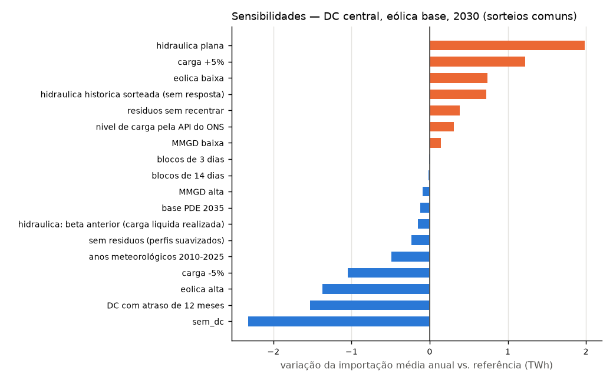

## 9. Conclusões

1. **A carga de data centers aumenta a importação.** Com a projeção oficial vigente (2,1 GWmed), a
   necessidade de importação do NE em 2030 aumenta ~2,3 TWh/ano e
   ~449 horas/ano com eólica base. O aumento aparece em
   todos os climas simulados, mas não muda o caráter exportador da região.
2. **O problema é temporal, não de energia.** A importação adicional concentra-se no fim da tarde e à
   noite. A eólica compensa a energia anual com ~4,6 GW,
   mas compensar a importação exige ~10,4 GW.
   Isso sugere que armazenamento ou flexibilidade (deslocar carga, baterias, hidráulica) seriam
   complementos naturais. O custo dessas alternativas não foi avaliado.
3. **A carga de data centers aproveitaria excedente.** 88%
   da energia dos data centers cairia em horas de excedente regional. Isso reduz o excedente acima do
   limite de exportação. Transformar isso em "corte evitado" exige análise de rede, fora do escopo.
4. **O clima pesa tanto quanto a decisão.** A variabilidade entre anos é da mesma ordem que a diferença
   entre cenários. Por isso os resultados devem ser comunicados como distribuições e diferenças pareadas,
   não como um número único.
5. **O efeito é mais confiável que o nível.** A validação retrospectiva mostra erro de dezenas de por
   cento no nível anual da importação. O efeito pareado dos data centers fica entre +1,7 e
   +2,8 TWh/ano em todas as hipóteses testadas, exceto o atraso.

## 10. Limitações e robustez

Algumas variáveis do estudo mudam rápido ou são pouco previsíveis:

| Variável | Por que é incerta | Velocidade de mudança | Efeito estimado (importação, caso central) | O que acompanhar |
|---|---|---|---|---|
| Carga de data centers | a projeção oficial para 2030 foi de 716 → 1.291 → 2.098 MWmed em ~8 meses | muito rápida (a cada revisão quadrimestral) | atraso de 12 meses: -1,5 TWh; cenário alto: +0,9 TWh | próximas revisões do PLAN; pareceres e contratos do ONS |
| Despacho hidráulico | depende da hidrologia do São Francisco e da operação do ONS; só 4 anos de dados horários | anual (hidrologia) e por política operativa | hidráulica plana: +2,0 TWh; histórico sem resposta: +0,7 TWh | série longa de vazões (P2 #13) |
| Nível da carga | crescimento econômico, clima, eletrificação | anual | ±5%: -1,0 / +1,2 TWh | revisões do PLAN |
| Expansão eólica | SIGA sem datas; cortes elevados desestimulam novos projetos | anual | baixa: +0,7; alta: -1,4 TWh | leilões, outorgas, fase no SIGA |
| Regime de cortes | taxa de horas com corte de 7% para 69% em 3 anos; calibração do classificador instável | rápida | não entra no balanço (o estudo mede excedente, não corte) | dados mensais de constrained-off |
| Clima do ano | variabilidade interanual do vento (ex.: 2009 fraco, 2012 forte) | não previsível no horizonte | explica 73% da variância da importação anual | tratado no Monte Carlo (31 anos) |
| MMGD | duas estimativas do ONS; crescimento acelerado | anual | faixa 1.939–2.718 MWmed: -0,1 a +0,1 TWh | PLAN; ANEEL |
| Limites de intercâmbio | importação sem limite documentado; exportação depende de obras até 2030 | por obra | não quantificado como risco | PAR/PEL do ONS, PDE |

**Limitações de método.**
- **Rede.** Não há representação da rede: excedente regional ≠ corte, e importação ≠ déficit. Cortes por
  restrição de rede em horas de importação aumentam a importação real e ficam de fora.
- **Erro do simulador.** Nos anos observados, a importação anual simulada difere da real em dezenas de
  por cento (seção 7.4). Nos anos da frota recente (2024–2026), a subestimação se
  repete. A causa principal é a eólica simulada ter poucas horas de pouco vento, e os resíduos sorteados
  não corrigem isso (seção 7.5).
- **Despacho.** A hidráulica segue uma regra emulada, não uma otimização; a térmica é histórica; a
  hidrologia é amostrada em só 4 anos.
  - O coeficiente da regra passou a ser estimado sobre a carga líquida potencial (decisão 52). Com o
    coeficiente anterior, sobre a carga já cortada, a importação de 2030 seria
    3% menor (seção 7.5).
- **Nível de carga.** A forma vem da API do ONS e o nível, do PLAN; em 2025 a API fica
  1,3% acima.
- **Data centers.** A carga é flat e igual à média anual; não há rampas dentro de 2030.
- **Cenário alto.** O projeto CDV_ACESSOS (266 MWmed) é um direito de acesso com processo oficial
  e pode já estar entre os pareceres favoráveis da 2ª RQ; nesse caso seria contado duas vezes.
- **Backtesting solar.** O modelo de curto prazo da solar prevê o CF observado, com corte; o eólico prevê
  o potencial.
- **Funções de transferência.** Partem da frota atual e do ERA5, que suaviza o jato noturno. Os resíduos
  vêm de 18 meses.
- **Cenários eólicos.** São hipóteses de fase, não um cronograma.
- **Dados de 2026.** São complementares, com anomalias no balanço de jan–mai.

## 11. Reprodutibilidade e engenharia

- **Execução.** `python -m src.pipeline` refaz tudo a partir de `data/raw` em ~20 min. Sementes fixas
  tornam os sorteios reprodutíveis (há teste automatizado).
- **Ambiente.** Python 3.14.1; dependências fixadas em `requirements.lock.txt`; sementes 20261111
  (modelos) e 20261112 (Monte Carlo).
- **Testes.** 40 testes automatizados (`pytest`):
  - unidades e fuso horário;
  - agregação 30 min → hora;
  - fechamento do balanço;
  - quebra da MMGD;
  - cardinalidade das junções;
  - extração do PDE e do PLAN;
  - cenários-limite do simulador;
  - reprodutibilidade dos sorteios;
  - conservação da energia hidráulica;
  - recentramento dos resíduos e níveis anuais do sorteio;
  - métricas da validação retrospectiva.
- **Rastreabilidade.** Manifesto com SHA-256 de cada arquivo bruto; `docs/decisoes.md` com 54 decisões
  numeradas (técnicas e do usuário); `STATUS.md` com o estado do projeto.
- **Versionamento.** Git local com commits por etapa. Dados não são versionados, só código, configuração
  e tabelas de resultado.

## 12. Decisões tomadas com o usuário

- **Carga base.** Forma horária pela carga da API do ONS, com a MMGD tratada como série própria.
- **Data centers.** Caso-base sem novos data centers; cenários pela projeção oficial e pelo inventário. O
  cenário alto inclui todos os pareceres e anúncios com MW.
- **Nível de carga e MMGD de 2030.** Ambos pela 2ª RQ do PLAN 2026–2030; PDE 2035 como sensibilidade.
- **Eólica alta.** 39,4 GW, com toda a expansão indicativa do PDE alocada ao NE.
- **Hidráulica.** Despacho histórico no determinístico; regra emulada no Monte Carlo; hidráulica plana
  como sensibilidade. Em 2026-11-17, coeficiente da regra estimado sobre a carga líquida potencial
  (decisão 52).
- **Clima.** ERA5 de 1995–2021 incluído para o Monte Carlo.

## 13. Referências

Referências metodológicas de apoio. A existência e os metadados de cada uma foram conferidos (Crossref,
JMLR ou DOI) em 2026-11-12; o texto não reproduz o conteúdo delas:
- Hersbach, H. et al. (2020). The ERA5 global reanalysis. *Q. J. R. Meteorol. Soc.*, 146(730),
  1999–2049. doi:10.1002/qj.3803.
- Staffell, I.; Pfenninger, S. (2016). Using bias-corrected reanalysis to simulate current and future
  wind power output. *Energy*, 114, 1224–1239. doi:10.1016/j.energy.2016.08.068.
- Hong, T.; Fan, S. (2016). Probabilistic electric load forecasting: A tutorial review. *Int. J.
  Forecasting*, 32(3), 914–938. doi:10.1016/j.ijforecast.2015.11.011.
- Künsch, H. R. (1989). The jackknife and the bootstrap for general stationary observations. *Annals of
  Statistics*, 17(3). doi:10.1214/aos/1176347265.
- Pedregosa, F. et al. (2011). Scikit-learn: Machine Learning in Python. *JMLR*, 12, 2825–2830.

**Fontes de dados.**
- ONS Dados Abertos e API de carga verificada.
- ANEEL Dados Abertos (SIGA, MMGD).
- EPE, PDE 2035.
- ONS/EPE/CCEE, notas técnicas e workshop do PLAN 2026–2030.
- IBGE/SIDRA (Censo 2022).
- Open-Meteo (ERA5).
- Portarias SNTEP/MME e imprensa setorial, citadas por projeto em `config/data_centers_ne.csv`.

## Anexo — Níveis de cenário por ano, 2026–2029 (simulador interativo)

Os resultados e as conclusões deste relatório são os de 2030. Para o simulador interativo
(`reports/site/simulador/index.html`, gerado por `python -m src.report.simulador`), os mesmos cenários
foram definidos para cada ano de 2026 a 2029 com as regras de `config/cenarios_anuais.yaml`
(`python -m src.sim.trajetorias`; tabela em `reports/sim/trajetorias_2026_2030.csv`):

| | 2026 | 2027 | 2028 | 2029 | 2030 (estudo) |
|---|---:|---:|---:|---:|---:|
| Carga sem DC (MWmed) | 14.070 | 14.663 | 15.044 | 15.551 | 16.180 |
| MMGD (MWmed) | 1.786 | 2.019 | 2.152 | 2.274 | 2.386 |
| Solar (MW) | 11.841 | 12.504 | 12.900 | 13.295 | 13.500 |
| Eólica baixa (MW) | 32.163 | 32.250 | 32.250 | 32.250 | 32.250 |
| Eólica base (MW) | 32.163 | 32.589 | 33.269 | 33.949 | 34.288 |
| Eólica alta (MW) | 32.163 | 32.589 | 34.969 | 37.349 | 39.388 |
| Data centers: sem DC (MWmed) | 0 | 0 | 0 | 0 | 0 |
| Data centers: conservador (MWmed) | 98 | 254 | 542 | 716 | 1.886 |
| Data centers: central (MWmed) | 112 | 333 | 628 | 813 | 2.098 |
| Data centers: alto (MWmed) | 126 | 412 | 714 | 976 | 2.753 |

- **Carga sem DC** (dado): carga global do NE na 2ª Revisão Quadrimestral do PLAN 2026–2030 menos a
  carga de data centers de Rede Básica da mesma revisão no ano (ex.: 2026 = 14.182 − 112).
- **MMGD** (dado): 2ª RQ do PLAN 2026–2030, NE, base + expansão.
- **Solar e eólica** (hipótese): capacidade média do ano. Usinas em operação no SIGA (em 2026,
  ponderadas pela data de entrada); a capacidade em construção entra de forma uniforme entre 2027 e
  2029 (fração média de 17%, 50% e 83% em 2027, 2028 e 2029) e está toda em
  operação em 2030, como no cenário do estudo. Eólica baixa = só operação; base = operação +
  construção; alta = base + expansão indicativa acumulada do PDE 2035 no ano (0; 0; 1,7; 3,4 GW de
  2026 a 2029), toda no NE. Em 2026 os três cenários eólicos coincidem.
- **Data centers**: os mesmos componentes dos cenários de 2030 aplicados à 2ª RQ de cada ano
  (conservador = contratos assinados; central = contratos + 50% dos pareceres; alto = contratos +
  100% dos pareceres + inventário M3 com a mesma rampa). O parecer de 2026 (rótulo ilegível no slide)
  é total − contratos = 14 MWmed.
- 2028 é bissexto: o simulador integra 8.784 horas, com 29/02 repetindo o clima e a hidrologia de 28/02.
- O simulador traz também um backtest de 2026 com os dados observados de janeiro a outubro.
